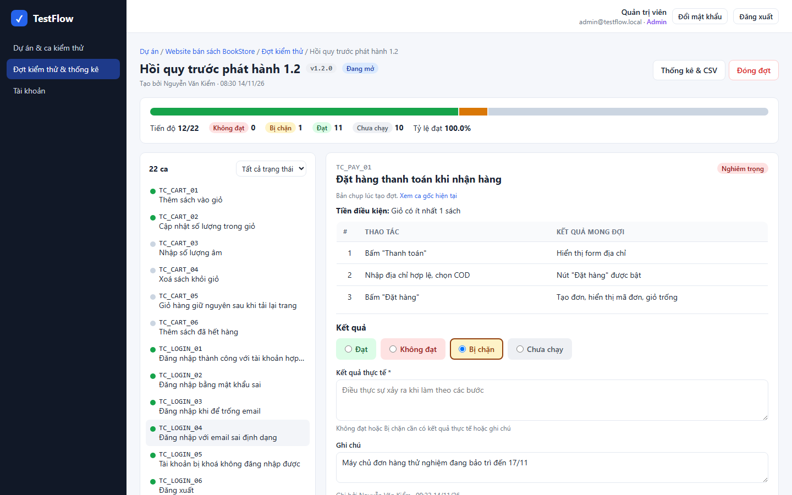

# TestFlow

Ứng dụng web quản lý ca kiểm thử và theo dõi kết quả **kiểm thử hồi quy** cho nhóm phát triển nhỏ (2–5 người).
Bài tập lớn học phần Đồ án chuyên ngành Công nghệ phần mềm, Trường Đại học Công nghệ Đông Á.
Sinh viên: Trần Đức Trường (20233802). Giảng viên hướng dẫn: ThS. Mai Văn Linh.



## Vấn đề

Sửa một chức năng có thể làm hỏng chức năng khác đã từng chạy đúng. Vì vậy trước mỗi lần phát hành, nhóm phải chạy lại các ca kiểm thử cũ. Nếu quản lý bằng bảng tính, mỗi phiên bản phải sao chép thêm một sheet, sửa ca thì lịch sử cũ bị lệch, ai có tệp cũng sửa được. TestFlow gom ca kiểm thử, các đợt chạy lại theo phiên bản và kết quả của chúng về một nơi, đồng thời **giữ lịch sử không bị thay đổi**.

TestFlow hỗ trợ kiểm thử thủ công: người kiểm thử làm theo các bước rồi ghi kết quả. Ứng dụng không tự chạy kiểm thử và không tự quyết định có phát hành hay không.

## Chức năng

| Nhóm | Nội dung |
| --- | --- |
| Tài khoản và phân quyền | Đăng nhập JWT, đổi mật khẩu; Admin quản lý tài khoản, khoá tài khoản có hiệu lực ngay |
| Dự án và bộ kiểm thử | Tạo, sửa, lưu trữ dự án (dự án đã lưu trữ chỉ được xem); nhóm ca theo bộ |
| Ca kiểm thử | Mã ca duy nhất trong dự án, tiền điều kiện, độ ưu tiên, các bước kèm kết quả mong đợi; tìm kiếm, lọc, phân trang |
| Đợt kiểm thử | Chọn phiên bản và các ca; **chụp lại nội dung ca** lúc tạo đợt; đóng đợt để chốt kết quả |
| Kết quả | Đạt, Không đạt, Bị chặn, Chưa chạy; kết quả thực tế, ghi chú; lịch sử của từng ca qua các đợt |
| Thống kê | Tiến độ, tỷ lệ đạt = Đạt / (Đạt + Không đạt), thống kê theo độ ưu tiên; **so sánh với đợt trước** chỉ ra ca thụt lùi, ca đã sửa; xuất CSV UTF-8 mở được bằng Excel |

## Kiến trúc

```
Trình duyệt (React 19 + TypeScript, Vite)  ──HTTP/JSON, JWT──▶  REST API (NestJS 11)  ──Prisma──▶  PostgreSQL 18
```

- Mọi quy tắc đặt tại backend. Mỗi yêu cầu đi qua xác thực (401), phân quyền (403), kiểm tra dữ liệu (400), rồi tới quy tắc nghiệp vụ.
- Có 8 bảng, gồm `RunCase` lưu bản chụp các bước dạng JSON. Xoá ca gốc thì `testCaseId = NULL` nhưng lịch sử vẫn còn.
- Tài liệu API (Swagger): http://localhost:3000/api/docs

## Chạy nhanh

Yêu cầu Node.js 22. **Không cần cài PostgreSQL hay Docker** vì dự án dùng PostgreSQL nhúng. Chi tiết xem [HUONG_DAN_CHAY.md](HUONG_DAN_CHAY.md).

```bash
cd backend && npm install && copy .env.example .env
npm run db:start                      # cửa sổ 1: PostgreSQL cổng 5433
npm run db:deploy && npm run db:seed  # cửa sổ 2, chỉ cần lần đầu
npm run start:dev                     # cửa sổ 2: API cổng 3000
cd frontend && npm install && npm run dev   # cửa sổ 3: http://localhost:5173
```

Tài khoản demo (dữ liệu giả lập): `admin@testflow.local` / `Admin@123`, `tester@testflow.local` / `Tester@123`.

## Chất lượng

| Hạng mục | Kết quả |
| --- | --- |
| Unit test (Jest) | 12/12 đạt |
| Kiểm thử API trên CSDL thật (TS-01…TS-44) | 44/44 đạt |
| E2E trên trình duyệt (Playwright) | 3/3 luồng đạt |
| Hiệu năng: 1.000 ca, 5 người dùng đồng thời | p95 = 33 ms (mục tiêu < 1 s) |
| Sao lưu và phục hồi CSDL | Thành công, dữ liệu khớp mã băm SHA-256 |

Nhật ký và số liệu gốc nằm trong [docs/ket-qua](docs/ket-qua).

## Thư mục

```
backend/    NestJS + Prisma: src/{auth,users,projects,suites,test-cases,runs,common}, test/, scripts/
frontend/   React: src/pages, src/components
e2e/        Playwright: 3 luồng E2E, kịch bản chụp màn hình
docs/       Báo cáo (bao-cao/), Chương 2, sơ đồ, ảnh giao diện, kết quả kiểm thử, kế hoạch
HO_SO_NOP/  Báo cáo, slide, phiếu tự đánh giá, báo cáo tiến độ (.docx/.pptx/.pdf)
```

## Tài liệu

- **[Hướng dẫn sử dụng, có ví dụ thực tế](docs/HUONG_DAN_SU_DUNG.md)** · [Triển khai lên Internet](docs/TRIEN_KHAI.md)
- [Kế hoạch dự án](docs/KE_HOACH_DU_AN.md) · [Chương 2: Phân tích và thiết kế](docs/CHUONG_2_PHAN_TICH_THIET_KE.md) · [Tiến độ hoàn thành](docs/TIEN_DO_HOAN_THANH.md)
- [Kịch bản demo và vấn đáp](docs/KICH_BAN_DEMO.md) · [Tài liệu ôn tập](docs/on-tap)
- Dựng lại hồ sơ nộp: `cd docs/build && npm install && npm run all` (cần Microsoft Office để xuất PDF)
