# Chương 2. Phân tích và thiết kế hệ thống

Chương này đặc tả yêu cầu của TestFlow và trình bày thiết kế để làm căn cứ cài đặt, kiểm thử. Nội dung gồm: tác nhân và yêu cầu (2.1), Use Case (2.2), Activity, kiến trúc, biểu đồ lớp và Sequence (2.3), thiết kế CSDL và quy tắc bảo toàn lịch sử (2.4), thiết kế API và giao diện (2.5).

Toàn bộ thiết kế trong chương đã được cài đặt và kiểm thử; kết quả cài đặt và kiểm thử trình bày ở Chương 3.

---

## 2.1. Tác nhân và yêu cầu

### 2.1.1. Tác nhân

Hệ thống có hai tác nhân. Admin kế thừa toàn bộ quyền của Tester và có thêm các quyền quản trị (Bảng 2.1).

*Bảng 2.1. Tác nhân của hệ thống*

| Tác nhân | Mô tả | Quyền |
| --- | --- | --- |
| **Tester** | Người viết ca, tạo đợt, thực hiện kiểm thử và ghi kết quả | Toàn bộ thao tác với dữ liệu kiểm thử: dự án, bộ, ca, đợt, kết quả, thống kê |
| **Admin** | Người quản trị nhóm, kế thừa Tester | Thêm: quản lý tài khoản, lưu trữ và mở lưu trữ dự án |

Phiên bản học phần áp dụng cho một nhóm dùng chung dữ liệu, chưa có phân quyền theo từng dự án hay mô hình nhiều tổ chức.

### 2.1.2. Yêu cầu chức năng

Sáu nhóm chức năng của đề cương được chi tiết hoá thành 20 yêu cầu (Bảng 2.2). Cột Tác nhân ghi tác nhân thấp nhất được phép; Admin dùng được mọi chức năng của Tester.

*Bảng 2.2. Yêu cầu chức năng*

| Mã | Chức năng | Tác nhân |
| --- | --- | --- |
| **FR01** | **Tài khoản và phân quyền** | |
| FR01.1 | Đăng nhập bằng email và mật khẩu | Tester |
| FR01.2 | Đăng xuất | Tester |
| FR01.3 | Đổi mật khẩu của chính mình | Tester |
| FR01.4 | Xem, tạo, sửa tài khoản; đặt lại mật khẩu; khoá và mở khoá | Admin |
| **FR02** | **Dự án và bộ kiểm thử** | |
| FR02.1 | Xem danh sách dự án, tìm theo tên | Tester |
| FR02.2 | Tạo, sửa dự án | Tester |
| FR02.3 | Lưu trữ và mở lưu trữ dự án | Admin |
| FR02.4 | Tạo, sửa, xoá bộ kiểm thử trong dự án | Tester |
| **FR03** | **Ca kiểm thử** | |
| FR03.1 | Tạo ca: mã, tên, tiền điều kiện, độ ưu tiên, bộ, danh sách bước | Tester |
| FR03.2 | Xem, sửa ca; thêm, xoá, sắp xếp lại bước | Tester |
| FR03.3 | Xoá ca | Tester |
| FR03.4 | Tìm theo mã, tên; lọc theo bộ, độ ưu tiên; phân trang | Tester |
| **FR04** | **Đợt kiểm thử** | |
| FR04.1 | Tạo đợt: tên, phiên bản, chọn danh sách ca; lưu bản chụp các ca | Tester |
| FR04.2 | Xem danh sách đợt của dự án, chi tiết đợt | Tester |
| FR04.3 | Đóng đợt | Tester |
| **FR05** | **Kết quả kiểm thử** | |
| FR05.1 | Ghi trạng thái (Chưa chạy, Đạt, Không đạt, Bị chặn), kết quả thực tế, ghi chú | Tester |
| FR05.2 | Xem lịch sử kết quả của một ca qua các đợt | Tester |
| **FR06** | **Thống kê và xuất CSV** | |
| FR06.1 | Thống kê đợt: số lượng theo trạng thái, tiến độ, tỷ lệ đạt | Tester |
| FR06.2 | Xuất kết quả đợt ra CSV, mở bằng Excel không lỗi dấu tiếng Việt | Tester |
| FR06.3 | So sánh đợt với đợt liền trước: chỉ ra ca thụt lùi, ca đã sửa, ca vẫn lỗi | Tester |

### 2.1.3. Sơ đồ phân cấp chức năng

Hình 2.1 phân rã hệ thống thành 6 nhóm chức năng, tương ứng FR01–FR06.

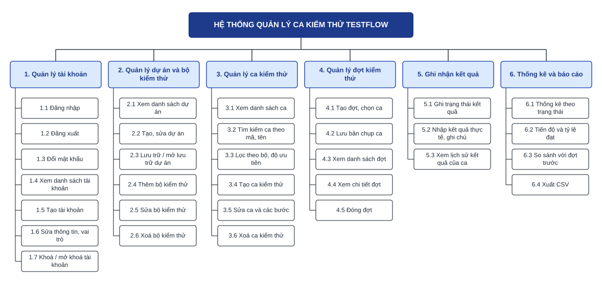

*Hình 2.1. Sơ đồ phân cấp chức năng*

### 2.1.4. Quy tắc nghiệp vụ

*Bảng 2.3. Quy tắc nghiệp vụ*

| Mã | Quy tắc |
| --- | --- |
| BR01 | Email tài khoản là duy nhất. Mật khẩu 8–72 ký tự, có cả chữ và số |
| BR02 | Tài khoản bị khoá không đăng nhập được; phiên đang dùng bị từ chối ngay |
| BR03 | Admin không tự hạ quyền hoặc tự khoá chính mình |
| BR04 | Tên dự án duy nhất, không phân biệt hoa thường. Tên bộ duy nhất trong một dự án |
| BR05 | Dự án đã lưu trữ chỉ được xem; mọi thao tác ghi lên dự án, bộ, ca, đợt của nó bị từ chối |
| BR06 | Mã ca 2–50 ký tự `[A-Z0-9_-]`, tự viết hoa, duy nhất trong một dự án |
| BR07 | Ca thuộc đúng một bộ, và bộ đó phải thuộc cùng dự án |
| BR08 | Ca có từ 1 đến 50 bước; mỗi bước bắt buộc có thao tác và kết quả mong đợi |
| BR09 | Không xoá bộ đang còn ca |
| BR10 | Đợt có ít nhất 1 ca; chỉ chọn ca thuộc cùng dự án; không chọn trùng một ca |
| BR11 | Tạo đợt và tạo bản chụp các ca thành công cùng nhau (một giao dịch) |
| BR12 | Sửa hoặc xoá ca gốc không làm thay đổi bản chụp trong các đợt đã tạo |
| BR13 | Chỉ đợt đang mở được ghi kết quả. Đợt đã đóng không mở lại; cần kiểm tra lại thì tạo đợt mới |
| BR14 | Kết quả Không đạt hoặc Bị chặn bắt buộc có kết quả thực tế hoặc ghi chú |
| BR15 | Tỷ lệ đạt = Đạt / (Đạt + Không đạt); mẫu số bằng 0 thì hiển thị "chưa có dữ liệu" |
| BR16 | So sánh với đợt liền trước trong cùng dự án: **thụt lùi** là trước Đạt nay Không đạt; **đã sửa** là trước Không đạt nay Đạt. Ca được ghép theo ca gốc; ca gốc đã bị xoá thì ghép theo mã ca |

### 2.1.5. Yêu cầu phi chức năng

*Bảng 2.4. Yêu cầu phi chức năng*

| Nhóm | Yêu cầu | Cách đáp ứng |
| --- | --- | --- |
| Bảo mật | Không lưu mật khẩu dạng rõ | Băm bcrypt, 10 vòng |
| | Kiểm tra quyền tại backend | Guard toàn cục: xác thực (401) rồi phân quyền (403) |
| | Kiểm tra dữ liệu nhập | DTO và ValidationPipe; từ chối trường không khai báo |
| | Không đưa cấu hình bí mật vào kho mã nguồn | `.env` nằm trong `.gitignore`, chỉ commit `.env.example` |
| Khả năng sử dụng | Giao diện và thông báo lỗi tiếng Việt | API trả thông báo lỗi tiếng Việt, giao diện hiển thị nguyên văn |
| | Danh sách có tìm kiếm, lọc, phân trang | Tham số `page`, `pageSize` (tối đa 100), `search` |
| | Xác nhận trước thao tác không hoàn tác | Hộp thoại xác nhận khi xoá, khi đóng đợt |
| Hiệu năng | API danh sách với 1.000 ca, 5 người dùng đồng thời, p95 dưới 1 giây | Chỉ mục `(projectId, suiteId)`, `(projectId, priority)`; phân trang |
| Vận hành | Sao lưu và phục hồi CSDL | Kịch bản sao lưu logic `npm run db:backup`, phục hồi `npm run db:restore` có kiểm tra mã băm; thử phục hồi một lần |
| Bảo trì | Mã nguồn chia theo chức năng; có tài liệu API | Mỗi chức năng một module NestJS; Swagger tại `/api/docs` |

---

## 2.2. Use Case

### 2.2.1. Biểu đồ Use Case tổng quát

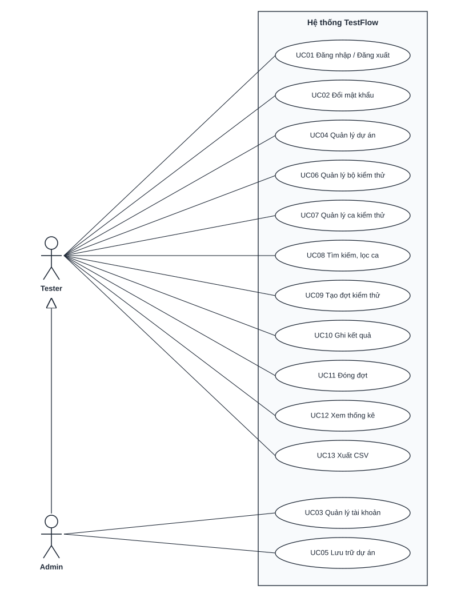

*Hình 2.2. Biểu đồ Use Case tổng quát*

Admin kế thừa Tester (mũi tên tam giác rỗng) nên dùng được mọi Use Case của Tester, cộng thêm UC03 và UC05. Mọi Use Case trừ UC01 đều yêu cầu đã đăng nhập.

### 2.2.2. Biểu đồ Use Case phân rã

Quan hệ giữa các Use Case dùng hai ký hiệu:

- **«include»**: phần bắt buộc, luôn thực hiện khi chạy Use Case gốc. Mũi tên đi từ Use Case gốc tới phần được gộp vào.
- **«extend»**: phần tuỳ chọn, chỉ xảy ra khi người dùng cần. Mũi tên đi từ phần mở rộng về Use Case gốc.

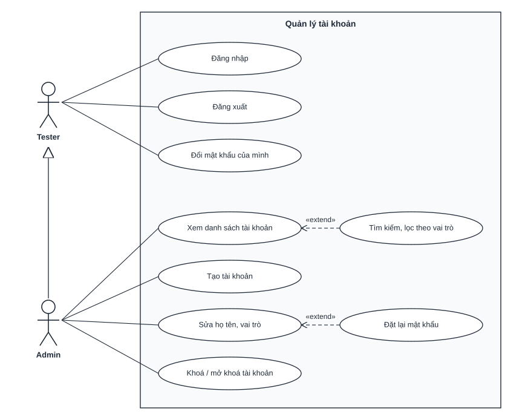

*Hình 2.3. Phân rã Use Case tài khoản (UC01–UC03)*

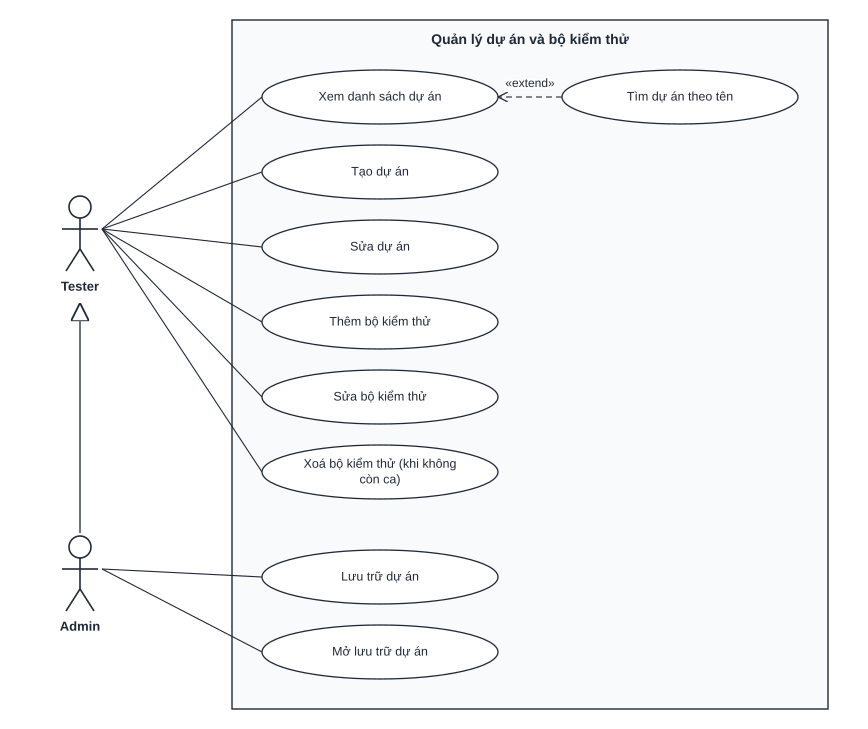

*Hình 2.4. Phân rã Use Case dự án và bộ kiểm thử (UC04–UC06)*

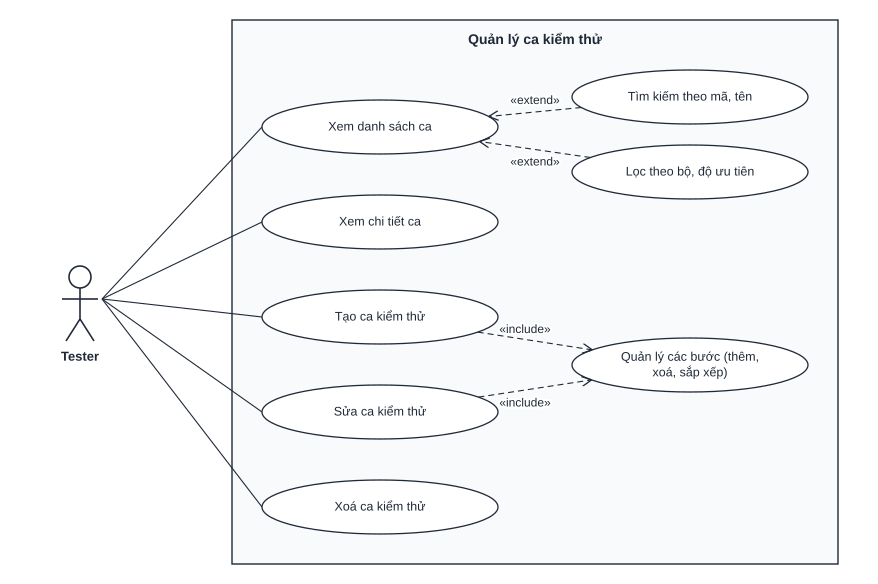

*Hình 2.5. Phân rã Use Case ca kiểm thử (UC07–UC08)*

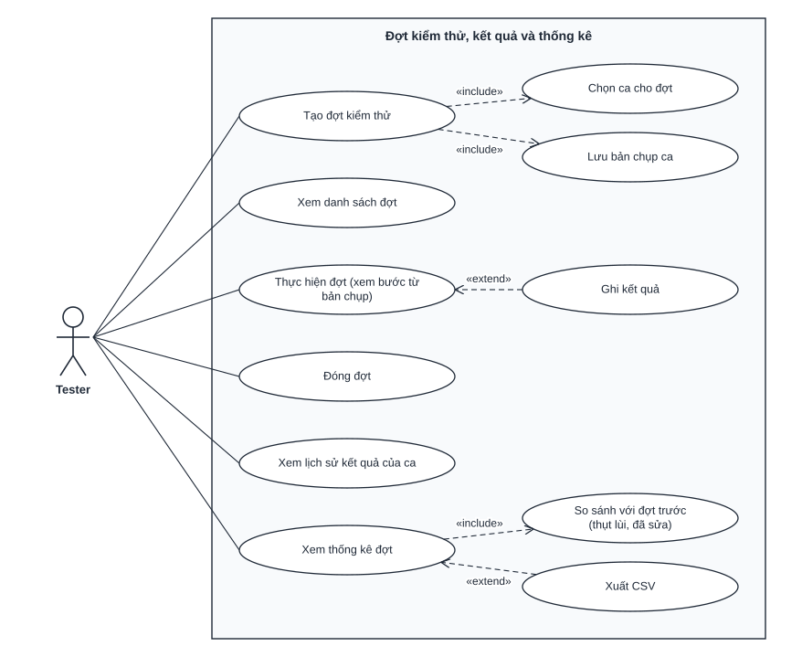

*Hình 2.6. Phân rã Use Case đợt kiểm thử, kết quả và thống kê (UC09–UC13)*

Ở Hình 2.5, tạo và sửa ca luôn gồm quản lý các bước vì một ca phải có ít nhất một bước (BR08). Ở Hình 2.6, tạo đợt luôn gồm chọn ca và lưu bản chụp (BR11); xem thống kê luôn gồm so sánh với đợt trước (BR16); xuất CSV là phần mở rộng tuỳ chọn của xem thống kê.

### 2.2.3. Đặc tả các Use Case chính

*Bảng 2.5. Đặc tả UC01 – Đăng nhập*

| Mục | Nội dung |
| --- | --- |
| Tác nhân | Tester, Admin |
| Tiền điều kiện | Chưa đăng nhập |
| Luồng chính | 1. Người dùng nhập email, mật khẩu, bấm Đăng nhập. 2. Hệ thống kiểm tra định dạng dữ liệu. 3. Hệ thống tìm tài khoản theo email, so mật khẩu với bản băm. 4. Hệ thống cấp token JWT (hạn 8 giờ) và trả thông tin người dùng. 5. Giao diện lưu token, chuyển tới trang Dự án. |
| Luồng thay thế | 2a. Sai định dạng: báo lỗi từng trường (400). 3a. Sai email hoặc mật khẩu: cùng một thông báo "Email hoặc mật khẩu không đúng" (401), không tiết lộ email nào tồn tại. 3b. Tài khoản bị khoá: "Tài khoản đã bị khoá" (401). |
| Hậu điều kiện | Mọi yêu cầu sau mang token trong header `Authorization` |
| Kiểm thử | TS-01 … TS-06 |

*Bảng 2.6. Đặc tả UC07 – Tạo ca kiểm thử*

| Mục | Nội dung |
| --- | --- |
| Tác nhân | Tester |
| Tiền điều kiện | Đã đăng nhập; dự án chưa lưu trữ và có ít nhất một bộ |
| Luồng chính | 1. Chọn dự án, bấm "+ Ca kiểm thử". 2. Nhập mã, tên, tiền điều kiện, độ ưu tiên, chọn bộ. 3. Thêm các bước (thao tác, kết quả mong đợi), có thể sắp xếp lại. 4. Bấm Tạo ca. 5. Hệ thống kiểm tra dữ liệu (BR06, BR08), dự án chưa lưu trữ (BR05), bộ thuộc dự án (BR07), mã chưa trùng (BR06). 6. Hệ thống lưu ca cùng các bước, đánh số bước 1..n. 7. Giao diện chuyển sang trang chi tiết ca. |
| Luồng thay thế | 5a. Thiếu trường hoặc không có bước: 400 kèm danh sách lỗi. 5b. Dự án đã lưu trữ: 400. 5c. Bộ thuộc dự án khác: 400. 5d. Trùng mã ca: 409. |
| Hậu điều kiện | Ca được ghi người tạo và thời điểm tạo |
| Kiểm thử | TS-17 … TS-21, TS-25 |

*Bảng 2.7. Đặc tả UC09 – Tạo đợt kiểm thử*

| Mục | Nội dung |
| --- | --- |
| Tác nhân | Tester |
| Tiền điều kiện | Đã đăng nhập; dự án đang hoạt động và có ít nhất một ca |
| Luồng chính | 1. Trong trang Đợt kiểm thử của dự án, bấm "+ Đợt kiểm thử". 2. Nhập tên đợt và phiên bản phần mềm. 3. Chọn các ca, có thể lọc theo bộ hoặc độ ưu tiên. 4. Bấm Tạo. 5. Hệ thống kiểm tra BR05, BR10. 6. Trong một giao dịch, hệ thống tạo đợt trạng thái Đang mở; với mỗi ca, tạo một bản chụp (mã, tên, tiền điều kiện, độ ưu tiên, các bước) và một kết quả Chưa chạy. 7. Giao diện hiển thị chi tiết đợt. |
| Luồng thay thế | 5a. Không chọn ca, chọn ca thuộc dự án khác hoặc chọn trùng: 400. 6a. Lỗi giữa chừng: huỷ toàn bộ, không để lại đợt dở dang. |
| Hậu điều kiện | Đợt có N bản chụp và N kết quả Chưa chạy |

*Bảng 2.8. Đặc tả UC10 – Ghi kết quả*

| Mục | Nội dung |
| --- | --- |
| Tác nhân | Tester |
| Tiền điều kiện | Đợt đang mở |
| Luồng chính | 1. Mở đợt, chọn một ca. 2. Đọc các bước từ bản chụp. 3. Thực hiện các bước trên phần mềm cần kiểm thử. 4. Chọn trạng thái, nhập kết quả thực tế và ghi chú. 5. Hệ thống kiểm tra đợt còn mở (BR13) và BR14. 6. Hệ thống lưu kết quả, ghi người thực hiện và thời điểm. |
| Luồng thay thế | 5a. Đợt đã đóng: 400, kết quả cũ giữ nguyên. 5b. Không đạt hoặc Bị chặn nhưng bỏ trống mô tả: 400. |
| Hậu điều kiện | Thống kê đợt cập nhật theo kết quả mới |

*Bảng 2.9. Đặc tả UC11 – Đóng đợt*

| Mục | Nội dung |
| --- | --- |
| Tác nhân | Tester |
| Tiền điều kiện | Đợt đang mở |
| Luồng chính | 1. Bấm "Đóng đợt". 2. Giao diện hiển thị số ca còn Chưa chạy và yêu cầu xác nhận. 3. Hệ thống chuyển đợt sang Đã đóng, ghi thời điểm đóng. |
| Luồng thay thế | 2a. Người dùng huỷ: không thay đổi. |
| Hậu điều kiện | Mọi yêu cầu sửa kết quả của đợt bị từ chối; đợt không mở lại được |

---

## 2.3. Activity, kiến trúc, biểu đồ lớp và Sequence

### 2.3.1. Biểu đồ Activity

Hình 2.7 mô tả một vòng kiểm thử hồi quy: tạo đợt, thực hiện từng ca, ghi kết quả, rồi tổng hợp và đóng đợt.

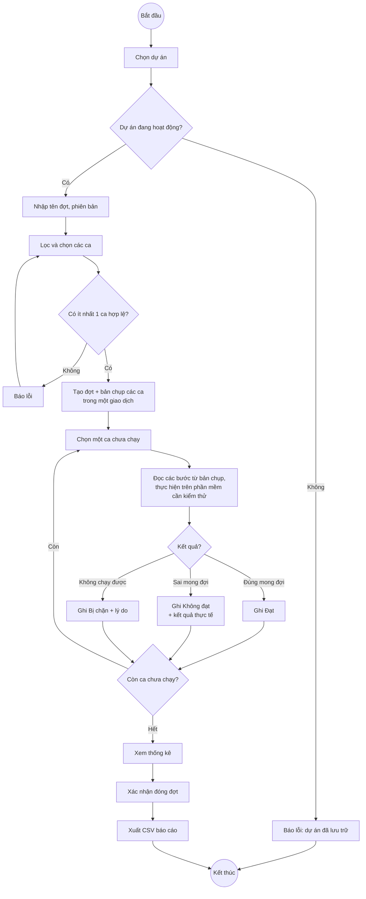

*Hình 2.7. Activity tạo đợt và thực hiện kiểm thử hồi quy*

### 2.3.2. Kiến trúc hệ thống

Hệ thống theo kiến trúc ba tầng: trình duyệt, REST API, CSDL (Hình 2.8). Giao diện không kết nối trực tiếp CSDL. Hệ thống dùng một backend duy nhất, chia module theo chức năng.

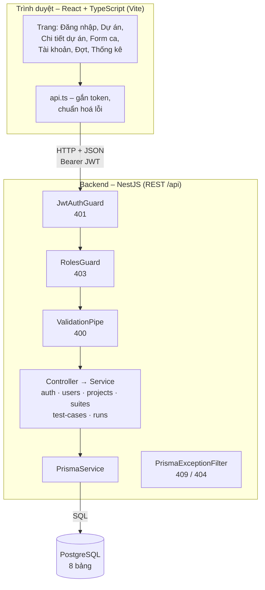

*Hình 2.8. Kiến trúc hệ thống*

Mỗi yêu cầu đi qua các lớp kiểm tra theo thứ tự cố định: xác thực trước, vì chưa biết người gọi là ai thì chưa thể xét quyền; phân quyền sau; cuối cùng mới kiểm tra dữ liệu và quy tắc nghiệp vụ.

### 2.3.3. Biểu đồ lớp

Hình 2.9 thể hiện các lớp thực thể và quan hệ giữa chúng.

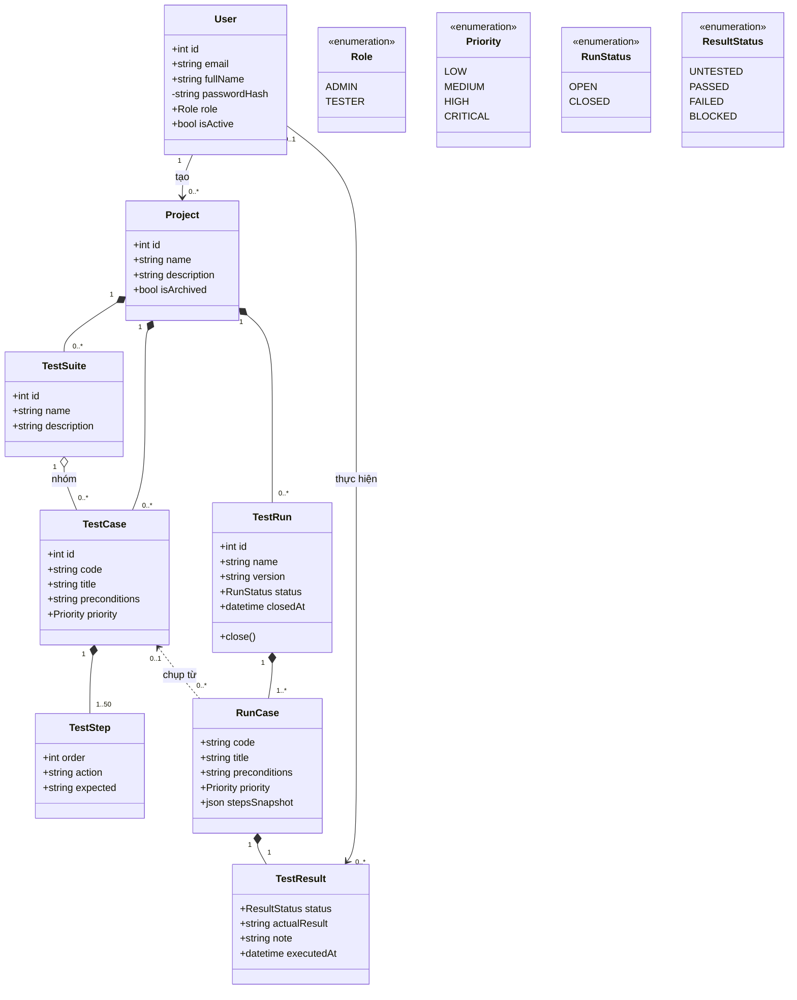

*Hình 2.9. Biểu đồ lớp thực thể*

Quan hệ giữa RunCase và TestCase là phụ thuộc yếu (0..1): bản chụp tồn tại độc lập, khi ca gốc bị xoá thì liên kết trở thành rỗng.

Phía backend, mỗi nhóm chức năng là một module gồm Controller (nhận yêu cầu) và Service (xử lý nghiệp vụ), như Bảng 2.10. Ba nhóm đợt, kết quả và thống kê cùng xoay quanh thực thể TestRun nên được gom vào một module `runs`.

*Bảng 2.10. Các module backend*

| Module | Controller | Service | Trách nhiệm chính |
| --- | --- | --- | --- |
| auth | AuthController | AuthService | Đăng nhập, cấp JWT, đổi mật khẩu |
| users | UsersController | UsersService | Quản lý tài khoản |
| projects | ProjectsController | ProjectsService | Dự án; hàm `getWritable()` dùng chung cho BR05 |
| suites | SuitesController | SuitesService | Bộ kiểm thử |
| test-cases | TestCasesController | TestCasesService | Ca và bước |
| runs | RunsController | RunsService | Tạo đợt kèm bản chụp, đóng đợt |
| runs | ResultsController | ResultsService | Ghi kết quả, lịch sử theo ca |
| runs | ReportsController | ReportsService | Thống kê, xuất CSV |
| common | – | – | Guard xác thực và phân quyền; decorator `@Public`, `@Roles`, `@CurrentUser`; phân trang; xử lý lỗi CSDL |

### 2.3.4. Biểu đồ Sequence

Hình 2.10 mô tả đăng nhập và cách một yêu cầu cần quyền Admin được kiểm tra.

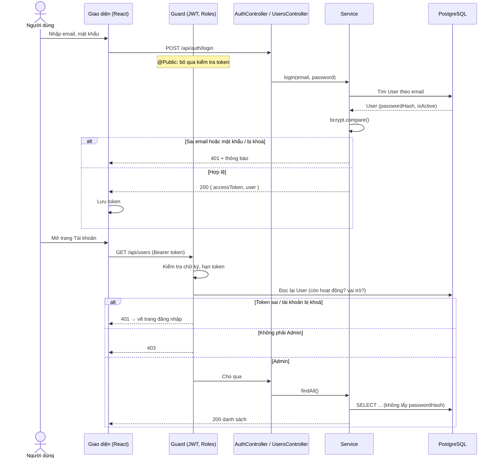

*Hình 2.10. Sequence đăng nhập và gọi API có kiểm tra quyền*

Hình 2.11 mô tả việc tạo đợt: đợt, các bản chụp và các kết quả ban đầu được ghi trong cùng một giao dịch.

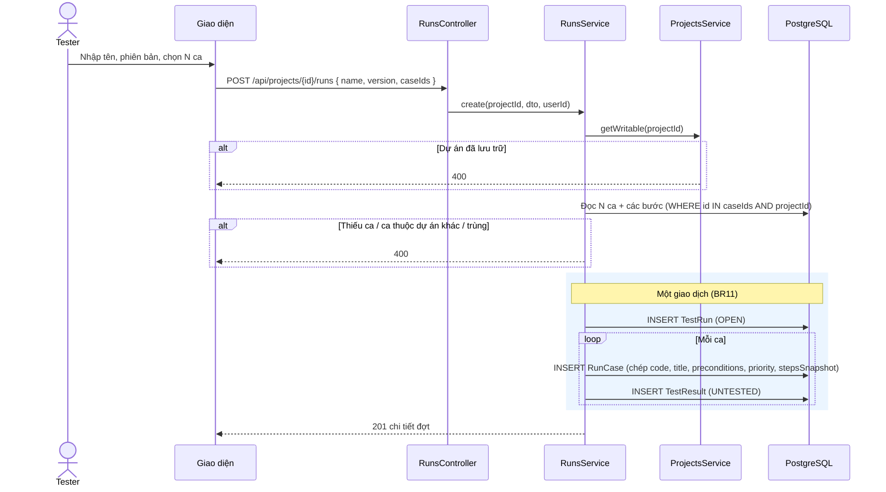

*Hình 2.11. Sequence tạo đợt kiểm thử và bản chụp*

Hình 2.12 mô tả việc ghi kết quả, gồm hai lần kiểm tra trước khi lưu: đợt còn mở và mô tả bắt buộc khi kết quả không đạt.

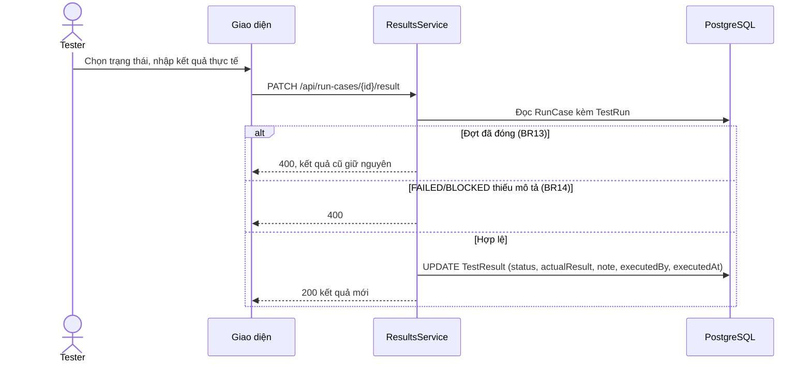

*Hình 2.12. Sequence ghi kết quả*

---

## 2.4. Thiết kế CSDL và quy tắc bảo toàn lịch sử

### 2.4.1. Mô hình thực thể – liên kết

CSDL gồm 8 bảng (Hình 2.13). Cả 8 bảng được tạo bằng một migration duy nhất `20261027172321_init_schema`. Trên sơ đồ lược bớt các cột thời gian `createdAt`, `updatedAt`; định nghĩa đầy đủ nằm trong `backend/prisma/schema.prisma`.

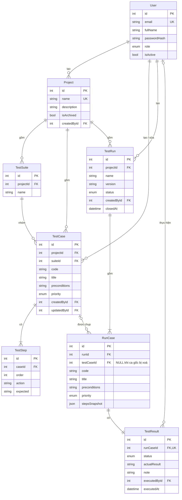

*Hình 2.13. Mô hình thực thể – liên kết (ERD)*

### 2.4.2. Ràng buộc toàn vẹn

Các quy tắc quan trọng được đặt cả ở tầng CSDL (Bảng 2.11), để dữ liệu vẫn đúng kể cả khi hai yêu cầu xảy ra đồng thời.

*Bảng 2.11. Ràng buộc toàn vẹn*

| Bảng | Ràng buộc | Mục đích |
| --- | --- | --- |
| User | `email` UNIQUE | BR01 |
| Project | `name` UNIQUE | BR04 |
| TestSuite | UNIQUE `(projectId, name)` | BR04 |
| TestCase | UNIQUE `(projectId, code)`; INDEX `(projectId, suiteId)`, `(projectId, priority)` | BR06; tăng tốc lọc theo bộ, độ ưu tiên |
| TestStep | UNIQUE `(caseId, order)`; FK `caseId` ON DELETE CASCADE | Thứ tự bước không trùng; xoá ca thì xoá các bước |
| RunCase | UNIQUE `(runId, testCaseId)`; FK `testCaseId` ON DELETE SET NULL; FK `runId` ON DELETE CASCADE | BR10: không chọn trùng ca; BR12: giữ bản chụp khi xoá ca gốc |
| TestResult | `runCaseId` UNIQUE | Mỗi ca trong đợt có đúng một kết quả hiện hành |

### 2.4.3. Quy tắc bảo toàn lịch sử

Lịch sử kết quả qua các phiên bản là giá trị cốt lõi của kiểm thử hồi quy, nên được bảo vệ bằng ba cơ chế phối hợp:

1. **Bản chụp.** Khi tạo đợt, nội dung ca được chép sang `RunCase`; các bước lưu dạng JSON `[{order, action, expected}]`. Màn hình thực hiện và báo cáo của đợt chỉ đọc bản chụp, không đọc ca gốc, nên sửa ca gốc không ảnh hưởng các đợt đã tạo.
2. **Không xoá dây chuyền.** Xoá ca gốc thì `RunCase.testCaseId` được đặt rỗng (SET NULL); bản chụp và kết quả còn nguyên. Dự án đã có lịch sử thì lưu trữ thay vì xoá.
3. **Khoá sau khi chốt.** Đợt đã đóng thì từ chối sửa kết quả; muốn kiểm tra lại thì tạo đợt mới.

Bản chụp làm dữ liệu bị lặp lại, và đây là lựa chọn có chủ đích. Chuẩn hoá nhằm tránh mâu thuẫn ở dữ liệu đang được sử dụng; còn bản chụp là dữ liệu lịch sử, phải phản ánh đúng thời điểm thực hiện, tương tự hoá đơn ghi lại giá tại lúc mua.

Giới hạn: mỗi ca trong đợt chỉ lưu kết quả hiện hành, chưa lưu mọi lần sửa kết quả bên trong cùng một đợt.

Cơ chế này được kiểm chứng bằng kịch bản: tạo ca → tạo đợt → ghi Không đạt → sửa ca gốc (thêm bước) → mở lại đợt cũ và xác nhận số bước, kết quả vẫn như lúc thực hiện.

---

## 2.5. Thiết kế API và giao diện

### 2.5.1. Quy ước API

- Tiền tố `/api`, dữ liệu dạng JSON. Tài liệu tương tác (Swagger) tại `/api/docs`.
- Xác thực bằng header `Authorization: Bearer <JWT>`. Chỉ `POST /api/auth/login` không cần token.
- API danh sách nhận `?page=&pageSize=&search=` và trả `{ items, total, page, pageSize }`; `pageSize` tối đa 100.
- Lỗi trả `{ statusCode, message, error }` với mã: **400** dữ liệu sai hoặc vi phạm quy tắc, **401** chưa xác thực, **403** không đủ quyền, **404** không tìm thấy, **409** trùng hoặc xung đột dữ liệu.

### 2.5.2. Danh sách API

Hệ thống có 30 API (Bảng 2.12). Cột Quyền ghi "Tester" nghĩa là mọi người đã đăng nhập, vì Admin kế thừa Tester.

*Bảng 2.12. Danh sách API (các đường dẫn đều có tiền tố /api)*

| Nhóm | Phương thức và đường dẫn | Quyền | Mô tả |
| --- | --- | --- | --- |
| Xác thực | `POST /auth/login` | Công khai | Đăng nhập, trả token |
| | `GET /auth/me` | Tester | Người dùng hiện tại |
| | `POST /auth/logout` | Tester | Đăng xuất (client xoá token) |
| | `PATCH /auth/password` | Tester | Đổi mật khẩu |
| Tài khoản | `GET /users` | Admin | Danh sách, lọc vai trò, tìm kiếm |
| | `POST /users` | Admin | Tạo tài khoản |
| | `PATCH /users/:id` | Admin | Sửa, đặt lại mật khẩu, khoá, mở khoá |
| Dự án | `GET /projects` | Tester | Danh sách, tuỳ chọn gồm dự án đã lưu trữ |
| | `GET /projects/:id` | Tester | Chi tiết kèm số bộ, ca, đợt |
| | `POST /projects` | Tester | Tạo dự án |
| | `PATCH /projects/:id` | Tester | Sửa dự án |
| | `PATCH /projects/:id/archive` | Admin | Lưu trữ |
| | `PATCH /projects/:id/unarchive` | Admin | Mở lưu trữ |
| Bộ kiểm thử | `GET /projects/:projectId/suites` | Tester | Danh sách bộ kèm số ca |
| | `POST /projects/:projectId/suites` | Tester | Tạo bộ |
| | `PATCH /suites/:id` | Tester | Sửa bộ |
| | `DELETE /suites/:id` | Tester | Xoá bộ (409 nếu còn ca) |
| Ca kiểm thử | `GET /projects/:projectId/cases` | Tester | Danh sách; tìm kiếm, lọc theo bộ, độ ưu tiên |
| | `POST /projects/:projectId/cases` | Tester | Tạo ca kèm các bước |
| | `GET /cases/:id` | Tester | Chi tiết kèm bước, người tạo, người sửa |
| | `PATCH /cases/:id` | Tester | Sửa; gửi kèm `steps` thì thay toàn bộ các bước |
| | `DELETE /cases/:id` | Tester | Xoá ca |
| | `GET /cases/:id/history` | Tester | Kết quả của ca qua các đợt |
| Đợt kiểm thử | `GET /projects/:projectId/runs` | Tester | Danh sách đợt kèm tiến độ |
| | `POST /projects/:projectId/runs` | Tester | Tạo đợt `{name, version, caseIds[]}` kèm bản chụp |
| | `GET /runs/:id` | Tester | Chi tiết đợt, các bản chụp và kết quả |
| | `PATCH /runs/:id/close` | Tester | Đóng đợt |
| Kết quả | `PATCH /run-cases/:id/result` | Tester | Ghi `{status, actualResult, note}` |
| Thống kê | `GET /runs/:id/stats` | Tester | Đếm theo trạng thái, tiến độ, tỷ lệ đạt; so sánh với đợt trước |
| | `GET /runs/:id/export.csv` | Tester | Tải CSV (UTF-8 có BOM để Excel đọc đúng dấu) |

### 2.5.3. Thiết kế giao diện

Giao diện dùng bố cục thống nhất: thanh bên trái là menu, thanh trên cùng hiển thị người dùng và vai trò. Nhãn tiếng Việt cho trạng thái và độ ưu tiên lấy từ một nguồn chung (`frontend/src/labels.ts`); lỗi từ API được hiển thị nguyên văn. Danh sách màn hình ở Bảng 2.13.

*Bảng 2.13. Các màn hình*

| Màn hình | Đường dẫn | Nội dung chính |
| --- | --- | --- |
| Đăng nhập | `/login` | Form email, mật khẩu; hiển thị tài khoản demo |
| Danh sách dự án | `/projects` | Thẻ dự án kèm số bộ, ca, đợt; tìm kiếm; hiện dự án đã lưu trữ; Admin có nút lưu trữ |
| Chi tiết dự án | `/projects/:id` | Bên trái: danh sách bộ (thêm, sửa, xoá). Bên phải: bảng ca có tìm kiếm, lọc độ ưu tiên, phân trang |
| Form ca | `/projects/:id/cases/new`, `/cases/:id` | Thông tin ca; danh sách bước thêm, xoá, sắp xếp; chỉ đọc khi dự án đã lưu trữ |
| Tài khoản | `/users` | Bảng tài khoản, tạo, sửa, khoá; chỉ Admin |
| Đổi mật khẩu | Hộp thoại từ thanh trên cùng | Mật khẩu hiện tại, mật khẩu mới |
| Danh sách đợt | `/projects/:id/runs` | Bảng đợt: tên, phiên bản, trạng thái, thanh tiến độ |
| Tạo đợt | `/projects/:id/runs/new` | Tên, phiên bản; bảng ca có ô chọn, lọc theo bộ, độ ưu tiên, chọn tất cả |
| Thực hiện đợt | `/runs/:id` | Bên trái: danh sách ca kèm trạng thái. Bên phải: các bước từ bản chụp, nút Đạt, Không đạt, Bị chặn, ô kết quả thực tế, ghi chú; nút Đóng đợt |
| Thống kê | `/runs/:id/report` | Số ca theo trạng thái, tiến độ, tỷ lệ đạt; so sánh với đợt trước (thụt lùi, đã sửa); danh sách ca không đạt; nút Xuất CSV |

### 2.5.4. Truy vết yêu cầu

Bảng 2.14 liên kết từng nhóm yêu cầu với Use Case, API và tình huống kiểm thử, dùng để đối chiếu khi nghiệm thu.

*Bảng 2.14. Truy vết yêu cầu*

| Yêu cầu | Use Case | API | Kiểm thử |
| --- | --- | --- | --- |
| FR01 | UC01, UC02, UC03 | `/auth/*`, `/users` | TS-01 … TS-15 |
| FR02 | UC04, UC05, UC06 | `/projects`, `/suites` | TS-12, TS-16, TS-24, TS-25 |
| FR03 | UC07, UC08 | `/cases` | TS-17 … TS-23, TS-26 |
| FR04 | UC09, UC11 | `/runs` | TS-27 … TS-32, TS-40, TS-43 |
| FR05 | UC10 | `/run-cases/:id/result`, `/cases/:id/history` | TS-33 … TS-36, TS-39, TS-41 |
| FR06 | UC12, UC13 | `/runs/:id/stats`, `/runs/:id/export.csv` | TS-33, TS-37, TS-38, TS-44 |

---

## Kết luận chương

Chương 2 đã xác định 2 tác nhân, 20 yêu cầu chức năng thuộc 6 nhóm, 16 quy tắc nghiệp vụ và các yêu cầu phi chức năng. Thiết kế gồm sơ đồ phân cấp chức năng, biểu đồ Use Case tổng quát và 4 biểu đồ phân rã, biểu đồ Activity, kiến trúc ba tầng, biểu đồ lớp, 3 biểu đồ Sequence, ERD 8 bảng, 30 API và 10 màn hình.

CSDL được thiết kế đủ 8 bảng ngay từ đầu nên khi cài đặt nhóm FR04–FR06 chỉ bổ sung module mới, không phải thay đổi cấu trúc dữ liệu. Điểm thiết kế trọng tâm là bản chụp ca theo đợt, kết hợp khoá đợt đã đóng và lưu trữ thay vì xoá, nhằm bảo toàn lịch sử kiểm thử hồi quy. Đây là cơ sở cho phần cài đặt và đánh giá ở Chương 3.
