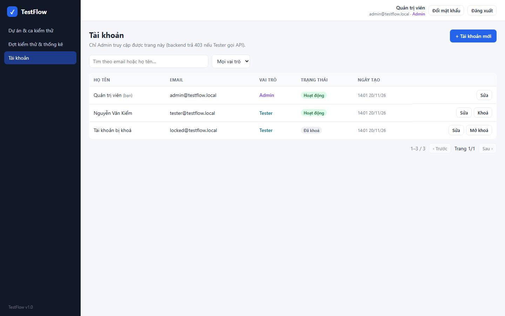
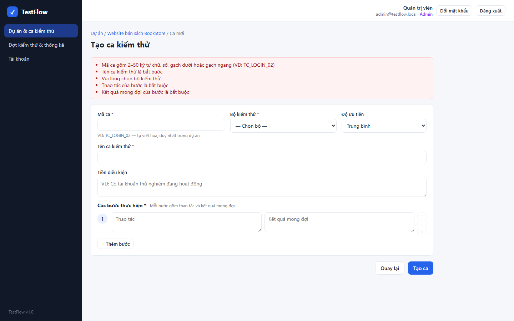
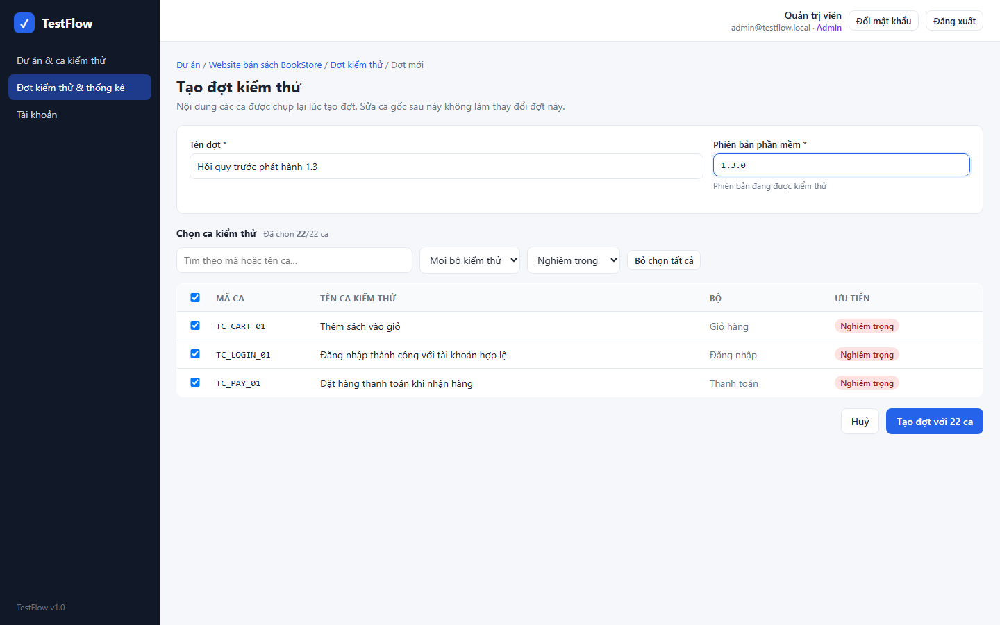
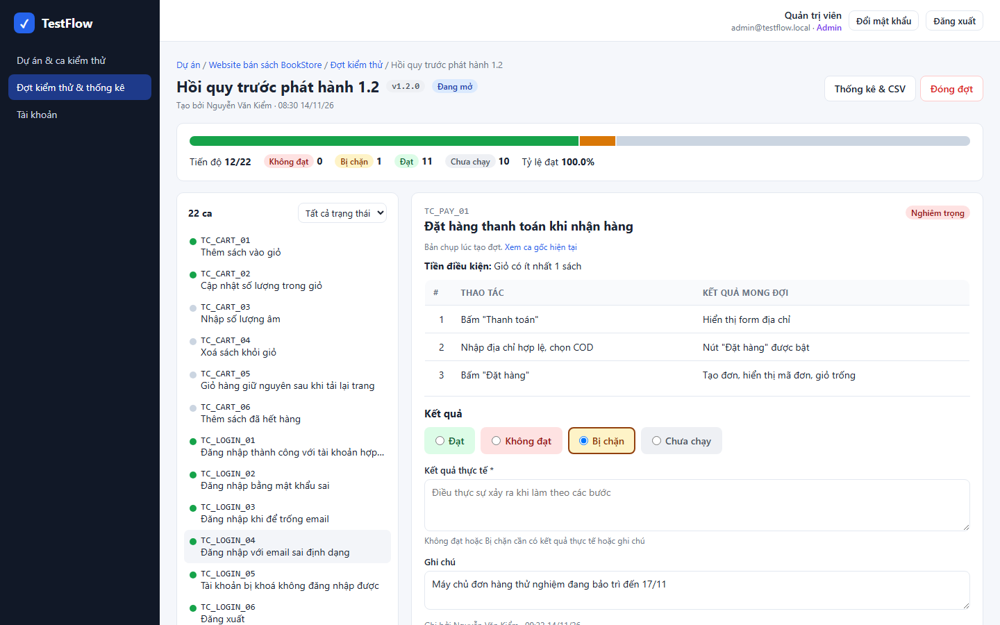
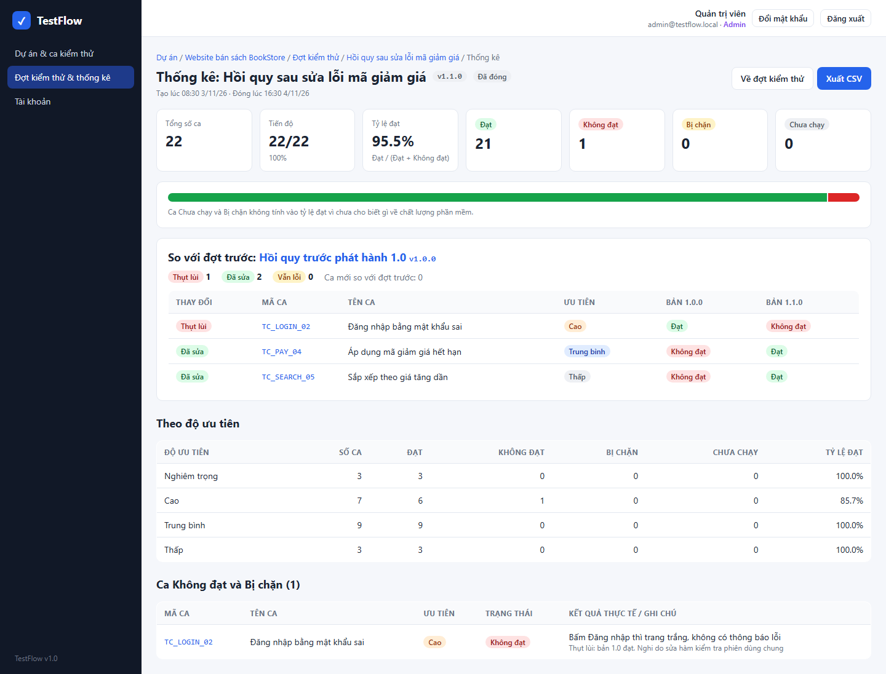
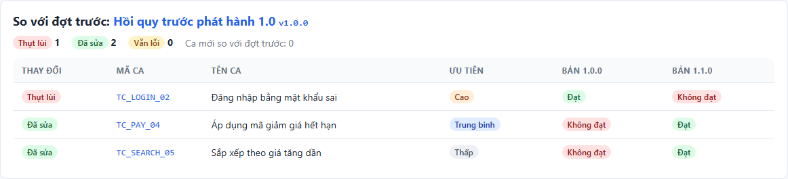
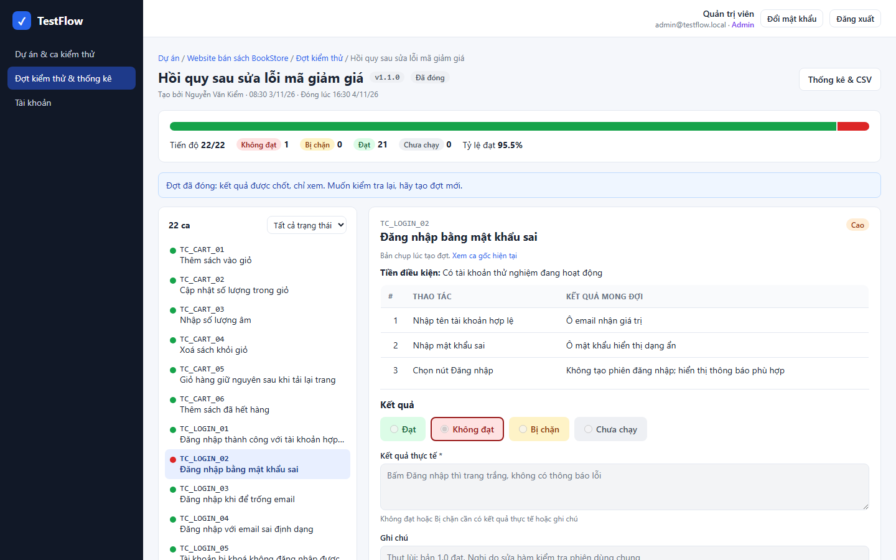
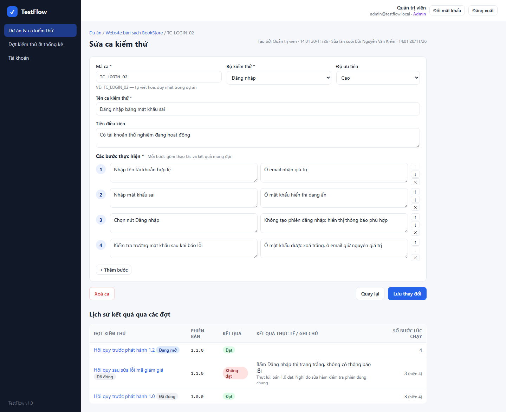
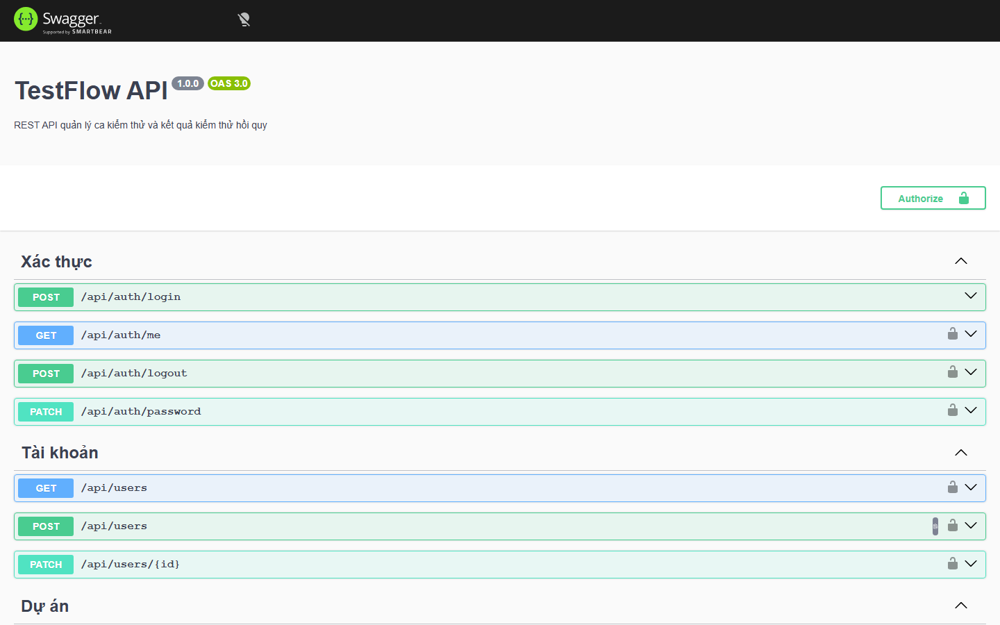

# Hướng dẫn sử dụng TestFlow

Tài liệu dành cho **người dùng cuối** (người kiểm thử, trưởng nhóm). Cách cài đặt xem [HUONG_DAN_CHAY.md](../HUONG_DAN_CHAY.md); cách đưa lên mạng xem [TRIEN_KHAI.md](TRIEN_KHAI.md).

Phần đầu giải thích khái niệm trong 2 phút. Phần chính là **một ví dụ thực tế đi từ đầu đến cuối**: nhóm BookStore kiểm thử hồi quy trước khi phát hành bản 1.3. Làm theo trên dữ liệu mẫu (`npm run db:seed`) là ra đúng màn hình như ảnh.

---

## 1. Hiểu trong 2 phút

| Khái niệm | Nghĩa | Ví dụ trong dữ liệu mẫu |
| --- | --- | --- |
| **Dự án** | Một phần mềm cần kiểm thử | Website bán sách BookStore |
| **Bộ kiểm thử** | Nhóm các ca theo chức năng | Đăng nhập, Giỏ hàng, Thanh toán |
| **Ca kiểm thử** | Một tình huống cần kiểm tra: tiền điều kiện, các bước, kết quả mong đợi | TC_LOGIN_02 "Đăng nhập bằng mật khẩu sai" |
| **Đợt kiểm thử** | Một lần chạy lại các ca trên **một phiên bản** phần mềm | "Hồi quy sau sửa lỗi mã giảm giá", bản 1.1.0 |
| **Bản chụp** | Nội dung ca được sao lại lúc tạo đợt; sửa ca gốc sau đó không làm đổi đợt cũ | Đợt 1.0 vẫn hiện 3 bước dù ca nay có 4 bước |
| **Kết quả** | Đạt, Không đạt, Bị chặn, Chưa chạy | |
| **Tỷ lệ đạt** | Đạt ÷ (Đạt + Không đạt). Bị chặn và Chưa chạy không tính | 21 Đạt, 1 Không đạt → 95,5% |
| **Thụt lùi** | Ca **đợt trước Đạt, đợt này Không đạt**: sửa chỗ này làm hỏng chỗ khác | TC_LOGIN_02 ở bản 1.1 |

Chọn kết quả thế nào cho đúng:

| Tình huống khi chạy | Chọn |
| --- | --- |
| Mọi bước ra đúng kết quả mong đợi | **Đạt** |
| Có bước ra sai: phần mềm có lỗi | **Không đạt**, bắt buộc ghi kết quả thực tế |
| Không chạy được vì lý do bên ngoài (máy chủ thanh toán thử nghiệm sập, chưa có dữ liệu) | **Bị chặn**, bắt buộc ghi lý do |
| Chưa làm tới | để **Chưa chạy** |

### Ai làm được gì

| Việc | Tester | Admin |
| --- | --- | --- |
| Xem, tạo, sửa dự án; bộ kiểm thử; ca kiểm thử | ✓ | ✓ |
| Tạo đợt, ghi kết quả, đóng đợt, xem thống kê, xuất CSV | ✓ | ✓ |
| Lưu trữ hoặc mở lại dự án | | ✓ |
| Tạo, sửa, khoá tài khoản; đặt lại mật khẩu | | ✓ |

Dự án đã **lưu trữ** chỉ xem được, không sửa. Đợt đã **đóng** không sửa kết quả được nữa và không mở lại được.

---

## 2. Ví dụ thực tế: kiểm thử hồi quy trước khi phát hành BookStore 1.3

**Bối cảnh.** Nhóm BookStore có 3 người. Bản 1.3 thêm chức năng *mã giảm giá cho thành viên hạng Vàng*. Trưởng nhóm (Admin) muốn biết trước khi phát hành: chức năng mới chạy đúng chưa, và **các chức năng cũ có bị hỏng theo không**. Các bước dưới đây diễn ra trong khoảng một buổi chiều.

### Bước 1. Admin cấp tài khoản cho người kiểm thử mới

Đăng nhập `admin@testflow.local` / `Admin@123` → menu **Tài khoản** → **Tạo tài khoản**:

| Trường | Nhập |
| --- | --- |
| Họ tên | Phạm Thị Lan |
| Email | lan@bookstore.vn |
| Vai trò | Tester |
| Mật khẩu | `Lan@2026` (Lan đổi lại sau lần đăng nhập đầu qua nút **Đổi mật khẩu**) |

> Khi một người rời nhóm, bấm **Khoá**: họ bị đăng xuất ở yêu cầu kế tiếp, không phải chờ hết phiên. Dữ liệu họ đã ghi vẫn giữ nguyên.

### Bước 2. Viết ca kiểm thử cho chức năng mới

Lan đăng nhập → **Website bán sách BookStore** → bộ **Thanh toán** → **+ Ca kiểm thử**.

| Trường | Nhập |
| --- | --- |
| Mã ca | `TC_PAY_08` (duy nhất trong dự án; trùng mã thì hệ thống từ chối) |
| Tên | Áp mã giảm giá cho thành viên hạng Vàng |
| Độ ưu tiên | Cao |
| Tiền điều kiện | Tài khoản hạng Vàng; giỏ có 2 sách, tổng 200.000đ; mã `VANG10` còn hiệu lực |

| # | Thao tác | Kết quả mong đợi |
| --- | --- | --- |
| 1 | Vào giỏ hàng, bấm **Thanh toán** | Hiện form thanh toán, tổng 200.000đ |
| 2 | Nhập mã `VANG10`, bấm **Áp dụng** | Báo "Đã áp dụng mã", giảm 20.000đ |
| 3 | Kiểm tra tổng tiền | Tổng còn 180.000đ |
| 4 | Đăng xuất, đăng nhập tài khoản hạng Thường, lặp lại bước 1–2 | Báo "Mã chỉ dành cho thành viên hạng Vàng", tổng giữ 200.000đ |

**Ca tốt và ca chưa tốt**, để viết đúng ngay lần đầu:

| Chưa tốt | Tốt |
| --- | --- |
| "Kiểm tra mã giảm giá" | "Áp mã giảm giá cho thành viên hạng Vàng" (đọc tên biết kiểm tra gì) |
| Kết quả mong đợi: "Chạy đúng" | "Tổng còn 180.000đ" (có con số để so) |
| Không có tiền điều kiện | Ghi rõ hạng tài khoản, giỏ hàng, mã còn hạn: người khác chạy lại được y hệt |
| Một bước làm 5 việc | Mỗi bước một thao tác, nên khi lỗi biết ngay hỏng ở bước nào |

Bỏ trống mã, tên hoặc không có bước nào thì hệ thống báo lỗi ngay trên form:

### Bước 3. Tạo đợt hồi quy cho bản 1.3

Menu **Đợt kiểm thử** → chọn dự án → **+ Đợt kiểm thử**.

| Trường | Nhập |
| --- | --- |
| Tên đợt | Hồi quy trước phát hành 1.3 |
| Phiên bản phần mềm | 1.3.0 |
| Chọn ca | Lọc độ ưu tiên **Nghiêm trọng**, chọn tất cả; lọc **Cao**, chọn thêm tất cả (gồm TC_PAY_08 vừa viết) |

> **Vì sao không chọn hết?** Trước một bản vá nhỏ, chạy hết 30 ca mất nửa ngày; chạy các ca Nghiêm trọng và Cao (khoảng 15 ca) mất một giờ mà vẫn bao được các luồng tiền bạc, đăng nhập. Trước bản lớn thì nên chọn hết.

Bấm **Tạo đợt với … ca**. Từ giây phút này, nội dung các ca được **chụp lại**: ai sửa ca gốc trong lúc Lan đang chạy cũng không làm lệch đợt này.

### Bước 4. Chạy và ghi kết quả

Mở đợt vừa tạo. Bên trái là danh sách ca kèm chấm màu trạng thái, bên phải là các bước của ca đang chọn.

Lan làm theo từng bước trên website BookStore thật, rồi ghi:

| Ca | Thực tế Lan thấy | Ghi trong TestFlow |
| --- | --- | --- |
| TC_LOGIN_01 Đăng nhập thành công | Đúng như mong đợi | **Đạt** |
| TC_PAY_08 Mã giảm giá hạng Vàng | Bước 4: tài khoản hạng Thường vẫn được giảm 20.000đ | **Không đạt**. Kết quả thực tế: *"Bước 4: tài khoản hạng Thường (thuong01@test.vn) nhập VANG10 vẫn được giảm, tổng 180.000đ. Mong đợi: báo lỗi, giữ 200.000đ."* |
| TC_PAY_01 Thanh toán khi nhận hàng | Máy chủ thanh toán thử nghiệm không phản hồi | **Bị chặn**. Ghi chú: *"Sandbox thanh toán lỗi 503 từ 14:00, đã báo anh Minh."* |

Lưu xong, trang tự chuyển sang ca kế tiếp, tiến độ và tỷ lệ đạt cập nhật ngay.

> Chọn **Không đạt** hoặc **Bị chặn** mà để trống cả kết quả thực tế lẫn ghi chú thì hệ thống không cho lưu. Một dòng mô tả tốt gồm: *bước nào, dữ liệu gì, thấy gì, mong đợi gì*. Lập trình viên đọc là tái hiện được, không phải hỏi lại.

### Bước 5. Lập trình viên sửa lỗi, trưởng nhóm đọc thống kê

Sau khi lập trình viên sửa TC_PAY_08 và máy chủ thanh toán chạy lại, Lan chạy lại hai ca đó và đổi thành **Đạt** (đợt còn mở thì vẫn sửa được). Trưởng nhóm bấm **Thống kê & CSV**:

Đọc theo thứ tự này:

1. **Tiến độ**: còn ca Chưa chạy hay Bị chặn không? Còn thì chưa đủ căn cứ để quyết định.
2. **Tỷ lệ đạt** và **Theo độ ưu tiên**: một ca *Nghiêm trọng* Không đạt nặng hơn nhiều so với một ca *Thấp*.
3. **So với đợt trước**: phần quan trọng nhất của kiểm thử hồi quy.

Ví dụ có sẵn trong dữ liệu mẫu (mở đợt **bản 1.1**): tỷ lệ đạt **tăng** từ 90,5% lên 95,5%, nghe như bản mới tốt hơn. Nhưng mục So với đợt trước chỉ ra **TC_LOGIN_02 thụt lùi**: bản 1.0 chạy đúng, bản 1.1 hỏng. Chỉ nhìn tỷ lệ thì lỗi này lọt ra người dùng.

| Nhãn | Nghĩa | Nên làm |
| --- | --- | --- |
| **Thụt lùi** | Đợt trước Đạt, đợt này Không đạt | Ưu tiên sửa trước khi phát hành: chức năng *đang dùng tốt* vừa bị hỏng |
| **Đã sửa** | Đợt trước Không đạt, đợt này Đạt | Xác nhận lỗi cũ đã được sửa |
| **Vẫn lỗi** | Không đạt ở cả hai đợt | Lỗi tồn đọng, cân nhắc có chấp nhận phát hành kèm không |

> Đợt so sánh là đợt **liền trước trong cùng dự án** (theo thời điểm tạo). Ca bị xoá rồi tạo lại cùng mã vẫn được ghép đúng nhờ so theo mã ca.

### Bước 6. Chốt đợt và gửi báo cáo

Khi đã quyết định phát hành, bấm **Đóng đợt** → xác nhận. Kết quả bị khoá lại làm căn cứ, không ai sửa được nữa.

Bấm **Xuất CSV** để gửi kèm email cho khách hàng hoặc lưu hồ sơ. Tệp mở thẳng bằng Excel, không lỗi tiếng Việt, phần đầu là tóm tắt (tổng số ca, tỷ lệ đạt), sau đó mỗi dòng một ca: mã, tên, độ ưu tiên, trạng thái, kết quả thực tế, ghi chú, người thực hiện, thời điểm. Mẫu: [vi-du-xuat-csv-dot-1.csv](ket-qua/vi-du-xuat-csv-dot-1.csv).

### Bước 7. Ba tháng sau: "TC_LOGIN_02 hỏng từ bản nào?"

Mở ca **TC_LOGIN_02**, kéo xuống **Lịch sử kết quả qua các đợt**:

Thấy ngay: 1.0 Đạt, 1.1 Không đạt, 1.2 Đạt lại. Cột *Số bước lúc chạy* cho biết mỗi đợt đã chạy phiên bản nội dung nào của ca, nên trả lời được cả câu "lúc đó kiểm tra những bước gì".

---

## 3. Những việc hay làm

| Muốn | Làm |
| --- | --- |
| Tìm ca | Trong dự án, gõ mã hoặc tên vào ô tìm kiếm; lọc theo bộ, độ ưu tiên |
| Đổi thứ tự bước | Nút Lên / Xuống cạnh mỗi bước trong form ca |
| Xoá bộ kiểm thử | Phải chuyển hoặc xoá hết ca trong bộ trước |
| Xoá ca đã từng chạy | Được; lịch sử ở các đợt cũ vẫn còn nguyên (bản chụp) |
| Dự án đã xong, không muốn ai sửa | Admin bấm **Lưu trữ**; cần sửa lại thì **Mở lại** |
| Kiểm tra lại sau khi đã đóng đợt | Tạo đợt mới. Đợt đóng là chốt sổ, không mở lại |
| Quên mật khẩu | Nhờ Admin **Đặt lại mật khẩu** trong trang Tài khoản |

## 4. Thông báo lỗi thường gặp

| Thông báo | Nguyên nhân | Cách xử lý |
| --- | --- | --- |
| Mã ca … đã tồn tại trong dự án | Trùng mã với ca khác | Đổi mã, ví dụ thêm số thứ tự |
| Dự án đã lưu trữ, không thể chỉnh sửa dữ liệu | Dự án ở trạng thái chỉ xem | Nhờ Admin mở lại |
| Đợt kiểm thử đã đóng, không thể sửa kết quả | Đợt đã chốt | Tạo đợt mới |
| Bộ kiểm thử còn ca kiểm thử… | Xoá bộ khi bộ còn ca | Chuyển ca sang bộ khác trước |
| Kết quả Không đạt hoặc Bị chặn cần mô tả… | Chọn Không đạt/Bị chặn mà bỏ trống mô tả | Ghi bước nào sai, thấy gì, hoặc lý do bị chặn |
| Tự về trang đăng nhập | Hết phiên 8 giờ, hoặc tài khoản vừa bị khoá | Đăng nhập lại; nếu bị khoá, liên hệ Admin |
| Không thể tự hạ quyền hoặc tự khoá… | Admin tự khoá chính mình | Nhờ Admin khác thao tác |

## 5. Dành cho người dùng kỹ thuật

- Mọi chức năng đều gọi được qua REST API; tài liệu và thử trực tiếp tại `/api/docs` (Swagger). Đăng nhập `POST /api/auth/login`, lấy `accessToken`, bấm **Authorize**.
- Quyền được kiểm tra ở máy chủ: Tester gọi `GET /api/users` sẽ nhận 403 dù gọi thẳng API.

