# Chương 3. Cài đặt, kiểm thử và đánh giá

Chương này trình bày kết quả cài đặt theo thiết kế ở Chương 2: môi trường phát triển và tổ chức mã nguồn, cài đặt từng nhóm chức năng kèm giao diện thực tế, dữ liệu mẫu, kết quả kiểm thử ở ba mức, đo hiệu năng, thử sao lưu và phục hồi, và cuối cùng là đánh giá mức độ hoàn thành so với mục tiêu.

## 3.1. Môi trường phát triển và tổ chức mã nguồn

### 3.1.1. Môi trường phát triển

*Bảng 3.1. Môi trường và phiên bản công nghệ*

| Thành phần | Phiên bản | Ghi chú |
| --- | --- | --- |
| Hệ điều hành | Windows 11 | Máy cá nhân: Intel Core i5-12500H, 16 GB RAM |
| Node.js | 22.12 | Chạy cả backend, công cụ build và kiểm thử |
| TypeScript | 5.7 | Dùng chung cho frontend và backend |
| NestJS | 11.2 | Backend REST API |
| Prisma | 6.19 | ORM và migration |
| PostgreSQL | 18 (embedded-postgres) | Chạy trong thư mục dự án, cổng 5433 |
| React / React Router | 19.3 / 7.18 | Giao diện |
| Vite | 6.4 | Máy chủ phát triển và đóng gói giao diện |
| Jest / Supertest | 29.7 / 7.3 | Unit test và kiểm thử API |
| Playwright | 1.56 (Chromium) | Kiểm thử đầu cuối, chụp ảnh giao diện |
| Git, GitHub | – | Quản lý mã nguồn |
| Visual Studio Code | – | Trình soạn thảo |

Toàn bộ công cụ miễn phí; không dùng dịch vụ trả phí, đúng mục tiêu chi phí 0 đồng của kế hoạch. Ứng dụng chạy trên localhost, gồm ba tiến trình: cơ sở dữ liệu (cổng 5433), API (cổng 3000) và giao diện (cổng 5173).

### 3.1.2. Tổ chức mã nguồn

Mã nguồn quản lý bằng Git, đặt trên GitHub, chia thành bốn phần: `backend`, `frontend`, `e2e` và `docs` (Bảng 3.2).

*Bảng 3.2. Cấu trúc thư mục mã nguồn*

| Thư mục | Nội dung |
| --- | --- |
| `backend/prisma` | `schema.prisma` (mô hình 8 thực thể), `migrations` (lịch sử thay đổi CSDL), `seed.ts` (dữ liệu mẫu) |
| `backend/src/auth`, `users` | Đăng nhập, JWT, đổi mật khẩu; quản lý tài khoản |
| `backend/src/projects`, `suites`, `test-cases` | Dự án, bộ kiểm thử, ca và bước |
| `backend/src/runs` | Đợt kiểm thử, ghi kết quả, thống kê và xuất CSV |
| `backend/src/common` | Guard xác thực, phân quyền; decorator; phân trang; bộ lọc lỗi CSDL |
| `backend/test` | Kiểm thử API TS-01…TS-44 |
| `backend/scripts` | Khởi động CSDL nhúng, đo hiệu năng, sao lưu và phục hồi |
| `frontend/src/pages` | 10 trang giao diện |
| `frontend/src/components` | Bố cục chung, thành phần giao diện dùng lại |
| `e2e/tests` | 3 luồng E2E và kịch bản chụp màn hình bằng Playwright |
| `docs` | Báo cáo, sơ đồ, ảnh giao diện, kết quả kiểm thử |

Tệp `.env` chứa khoá bí mật JWT và chuỗi kết nối CSDL không được đưa lên kho mã nguồn; kho chỉ chứa `.env.example` với giá trị mẫu.

## 3.2. Cài đặt các nhóm chức năng

### 3.2.1. Xử lý chung: xác thực, phân quyền, kiểm tra dữ liệu

Mọi yêu cầu tới API đi qua chuỗi kiểm tra cố định đã thiết kế ở Hình 2.8:

1. **JwtAuthGuard** (đăng ký toàn cục): kiểm tra header `Authorization`, xác minh chữ ký và hạn của token, sau đó **đọc lại người dùng từ CSDL**. Nhờ bước đọc lại này, tài khoản vừa bị khoá hoặc đổi vai trò có hiệu lực ngay, không phải chờ token hết hạn sau 8 giờ. Route đăng nhập được đánh dấu `@Public()` để bỏ qua bước này.
2. **RolesGuard**: nếu route có `@Roles(Role.ADMIN)` mà người gọi không phải Admin thì trả 403.
3. **ValidationPipe**: đối chiếu dữ liệu với DTO, tự cắt khoảng trắng, chuyển kiểu; tuỳ chọn `whitelist` và `forbidNonWhitelisted` từ chối mọi trường không khai báo, chặn kiểu tấn công gửi thêm `role: "ADMIN"` khi tạo hoặc sửa dữ liệu.
4. **Service**: áp dụng quy tắc nghiệp vụ.
5. **PrismaExceptionFilter**: chuyển lỗi ràng buộc của CSDL thành mã HTTP dễ hiểu (409 khi trùng, 404 khi không tìm thấy) thay vì lỗi 500.

Thứ tự đăng ký guard có chủ đích: chưa biết người gọi là ai thì chưa thể xét quyền.

```
@Module({
  imports: [PrismaModule, AuthModule, UsersModule, ProjectsModule,
            SuitesModule, TestCasesModule, RunsModule],
  providers: [
    // Thứ tự quan trọng: xác thực (401) trước, phân quyền (403) sau.
    { provide: APP_GUARD, useClass: JwtAuthGuard },
    { provide: APP_GUARD, useClass: RolesGuard },
  ],
})
export class AppModule {}
```

Thông báo lỗi trả về bằng tiếng Việt và hiển thị nguyên văn trên giao diện. Khi đăng nhập sai, hệ thống trả cùng một thông báo "Email hoặc mật khẩu không đúng" cho cả hai trường hợp sai email và sai mật khẩu, để không tiết lộ email nào đã có tài khoản.

### 3.2.2. Tài khoản và phân quyền

Màn hình đăng nhập (Hình 3.1) hiển thị tài khoản demo. Admin quản lý tài khoản tại màn hình Tài khoản (Hình 3.2): tạo tài khoản, đổi vai trò, đặt lại mật khẩu, khoá hoặc mở khoá. Admin không thể tự khoá hoặc tự hạ quyền chính mình, để hệ thống luôn còn người quản trị. Mật khẩu băm bằng bcrypt 10 vòng; API không bao giờ trả trường `passwordHash`.

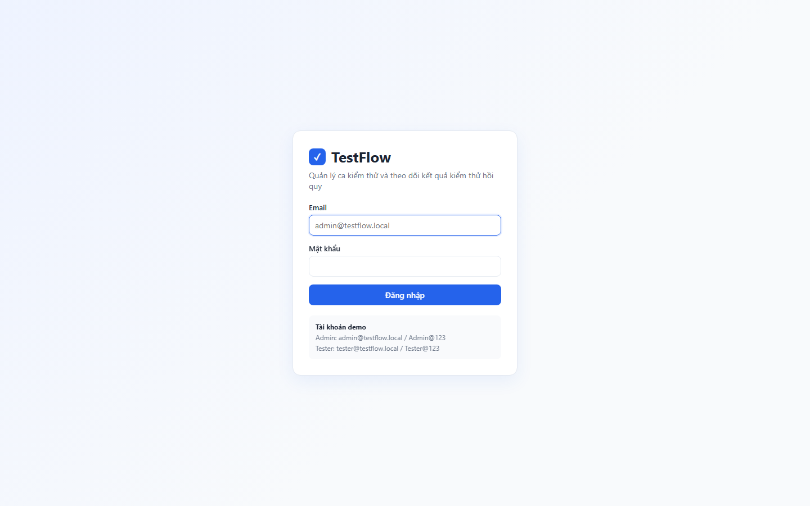

*Hình 3.1. Màn hình đăng nhập*

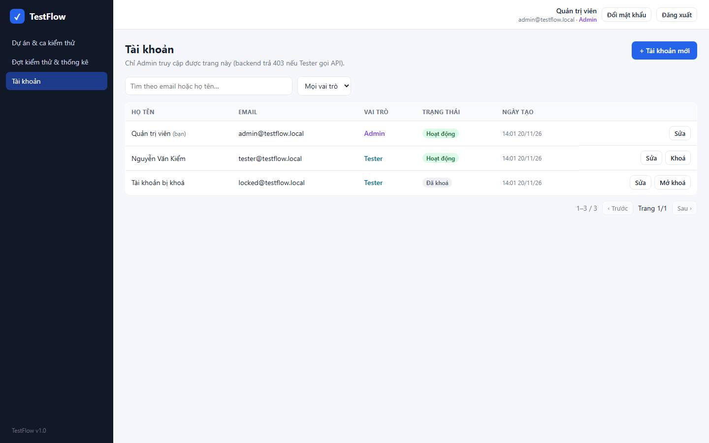

*Hình 3.2. Màn hình quản lý tài khoản (chỉ Admin)*

Phía giao diện, menu Tài khoản chỉ hiện với Admin và đường dẫn `/users` chuyển hướng Tester về trang Dự án. Đây chỉ là biện pháp hỗ trợ trải nghiệm; lớp bảo vệ thật là `@Roles(Role.ADMIN)` tại backend, được kiểm chứng bởi TS-10, TS-11, TS-12.

### 3.2.3. Dự án và bộ kiểm thử

Màn hình danh sách dự án (Hình 3.3) hiển thị mỗi dự án kèm số bộ, số ca và số đợt. Admin có thêm nút lưu trữ. Màn hình chi tiết dự án (Hình 3.4) chia hai cột: danh sách bộ kiểm thử bên trái (thêm, sửa, xoá) và bảng ca bên phải có tìm kiếm, lọc theo độ ưu tiên và phân trang.

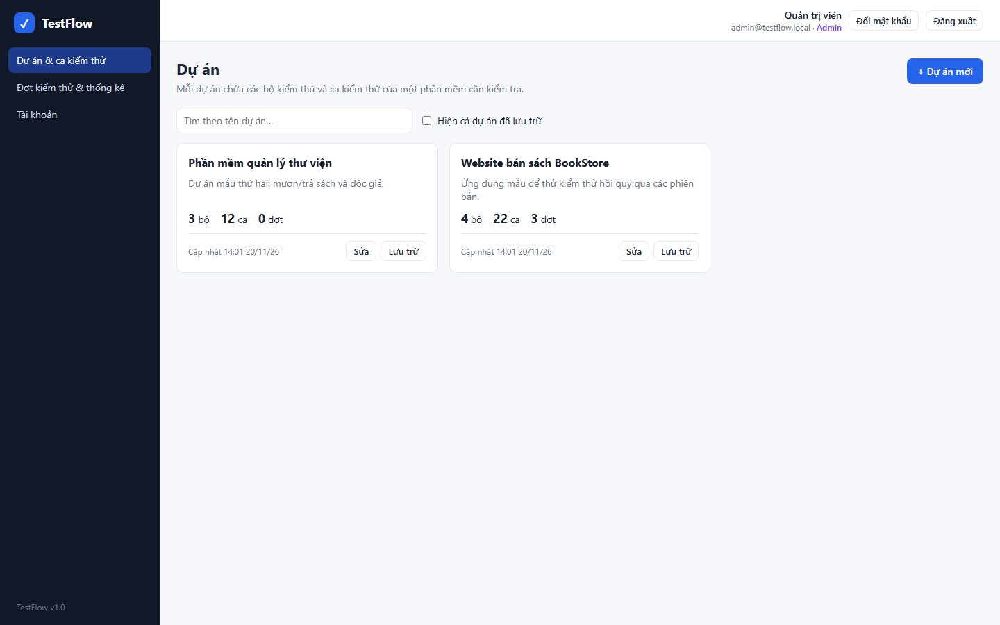

*Hình 3.3. Màn hình danh sách dự án*

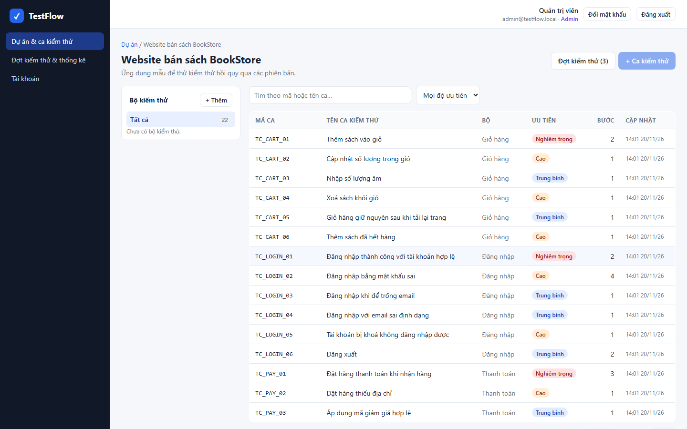

*Hình 3.4. Màn hình chi tiết dự án: bộ kiểm thử và danh sách ca*

Quy tắc "dự án đã lưu trữ chỉ được xem" được cài đặt tập trung ở một hàm `getWritable()` của `ProjectsService`. Mọi thao tác ghi lên bộ, ca và đợt đều gọi hàm này trước, nên quy tắc không bị bỏ sót ở bất kỳ chức năng nào:

```
async getWritable(id: number) {
  const project = await this.findOne(id);
  if (project.isArchived) {
    throw new BadRequestException('Dự án đã lưu trữ, không thể chỉnh sửa dữ liệu');
  }
  return project;
}
```

### 3.2.4. Ca kiểm thử

Biểu mẫu ca (Hình 3.5) cho phép nhập mã, bộ, độ ưu tiên, tên, tiền điều kiện và danh sách bước; mỗi bước có thể thêm, xoá hoặc đổi thứ tự. Khi gửi thiếu dữ liệu, backend trả về danh sách lỗi tiếng Việt và giao diện hiển thị đầy đủ (Hình 3.6). Mã ca tự viết hoa và phải duy nhất trong dự án; bộ được chọn phải thuộc cùng dự án.

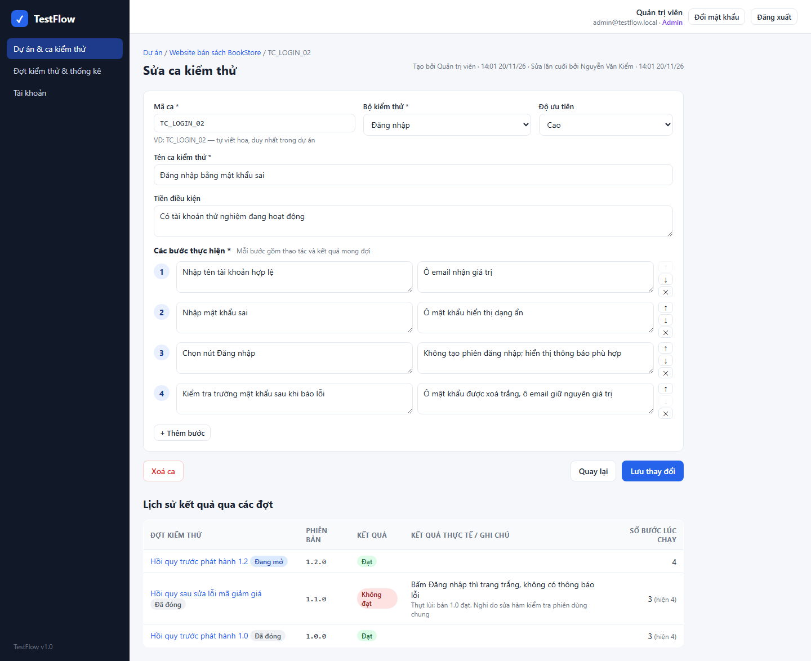

*Hình 3.5. Biểu mẫu ca kiểm thử và lịch sử kết quả qua các đợt*

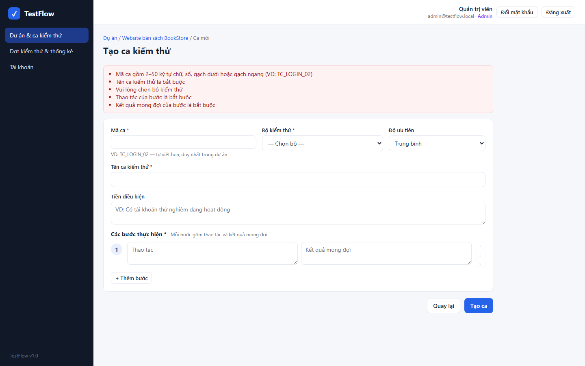

*Hình 3.6. Kiểm tra dữ liệu: gửi biểu mẫu trống*

Khi sửa ca có gửi kèm danh sách bước, toàn bộ bước cũ được thay bằng danh sách mới trong **một giao dịch**. Nếu tạo bước mới lỗi giữa chừng, việc xoá bước cũ cũng bị huỷ, nên ca không bao giờ rơi vào trạng thái mất hết bước.

Phần dưới biểu mẫu là bảng lịch sử kết quả của ca qua các đợt. Ở Hình 3.5, ca TC_LOGIN_02 hiện có 4 bước, còn hai đợt cũ ghi "3 (hiện 4)": đợt chạy với 3 bước, sau đó ca mới được bổ sung bước thứ tư. Lịch sử cho thấy ca Đạt ở bản 1.0, Không đạt ở bản 1.1 (thụt lùi) và Đạt lại ở bản 1.2.

### 3.2.5. Đợt kiểm thử và bản chụp

Màn hình danh sách đợt của dự án (Hình 3.7) liệt kê các đợt, mới nhất ở trên, kèm phiên bản, trạng thái, thanh tỉ lệ kết quả, tiến độ và tỷ lệ đạt. Đọc theo hàng dọc, người dùng thấy ngay diễn biến chất lượng qua các phiên bản.

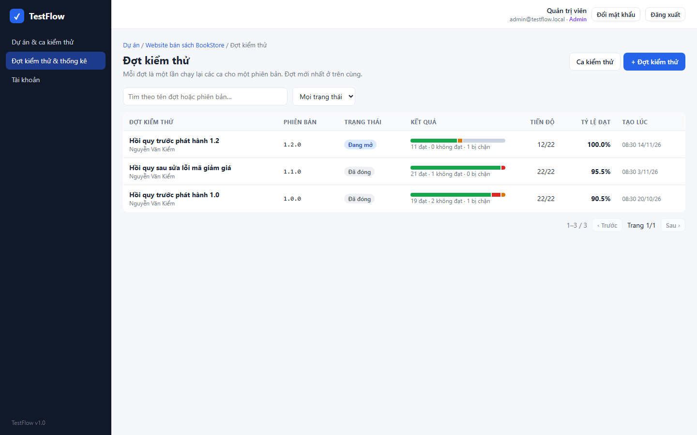

*Hình 3.7. Danh sách đợt kiểm thử: kết quả hồi quy qua ba phiên bản*

Màn hình tạo đợt (Hình 3.8) yêu cầu tên đợt và phiên bản; mặc định chọn toàn bộ ca (hồi quy đầy đủ), người dùng có thể lọc theo bộ, độ ưu tiên, từ khoá và bỏ chọn bớt.

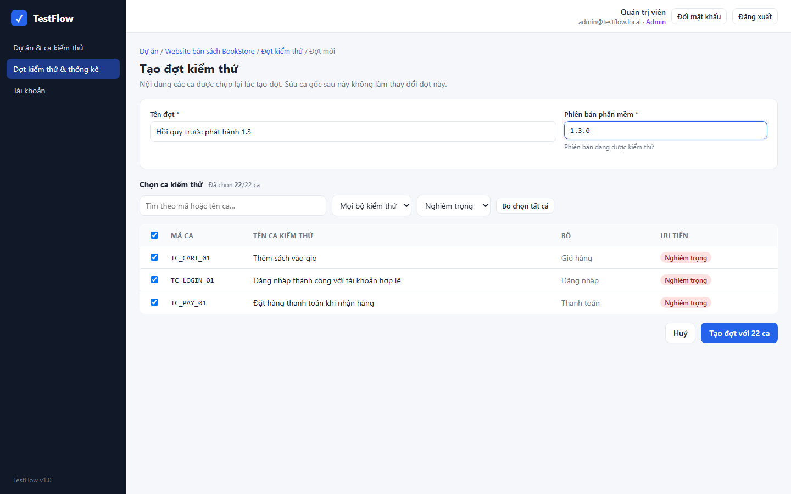

*Hình 3.8. Màn hình tạo đợt kiểm thử, lọc các ca mức Nghiêm trọng*

Bản chụp được tạo trong `RunsService.create`. Đợt, các bản chụp và các kết quả "Chưa chạy" được ghi bằng một lệnh tạo lồng nhau, tức một giao dịch duy nhất:

```
const run = await this.prisma.testRun.create({
  data: {
    projectId, name: dto.name, version: dto.version, createdById: userId,
    runCases: {
      create: cases.map((c) => ({
        testCaseId: c.id, code: c.code, title: c.title,
        preconditions: c.preconditions, priority: c.priority,
        stepsSnapshot: c.steps.map(({ order, action, expected }) =>
          ({ order, action, expected })),
        result: { create: {} },          // kết quả ban đầu: Chưa chạy
      })),
    },
  },
});
```

Trước khi tạo, service kiểm tra mọi ca được chọn đều thuộc dự án; DTO từ chối danh sách rỗng và ca bị chọn trùng. Nếu một ca không hợp lệ, toàn bộ yêu cầu bị từ chối và không để lại đợt dở dang (TS-30).

### 3.2.6. Thực hiện đợt và ghi kết quả

Màn hình thực hiện đợt (Hình 3.9) là màn hình làm việc chính của Tester. Phía trên là thanh tỉ lệ kết quả và các con số tổng hợp. Bên trái là danh sách ca, mỗi ca có chấm màu theo trạng thái và có thể lọc theo trạng thái. Bên phải là bản chụp của ca đang chọn (tiền điều kiện, các bước, kết quả mong đợi) và biểu mẫu ghi kết quả gồm bốn nút trạng thái, ô kết quả thực tế và ô ghi chú. Sau khi lưu, trang tự chuyển sang ca chưa chạy kế tiếp để người dùng thao tác liên tục.

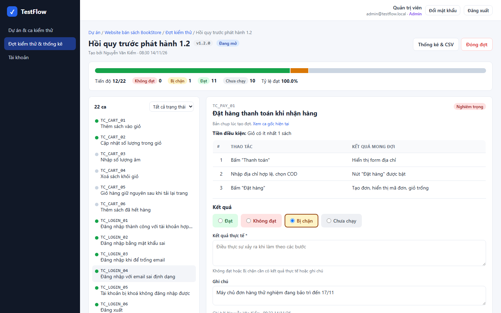

*Hình 3.9. Màn hình thực hiện đợt: ca đang Bị chặn kèm lý do*

Khi ghi kết quả, `ResultsService` kiểm tra ba điều: đợt còn mở, dự án chưa lưu trữ, và kết quả Không đạt hoặc Bị chặn phải có kết quả thực tế hoặc ghi chú (BR14). Hệ thống tự ghi người thực hiện và thời điểm. Màn hình cũng có liên kết "Xem ca gốc hiện tại"; nếu ca gốc đã bị xoá, màn hình ghi rõ lịch sử vẫn được giữ.

Đóng đợt yêu cầu xác nhận, kèm cảnh báo số ca còn chưa chạy. Sau khi đóng, đợt chuyển sang chỉ đọc (Hình 3.10): các ô nhập bị vô hiệu hoá, nút lưu và nút đóng biến mất, và API từ chối mọi yêu cầu sửa kết quả (TS-41).

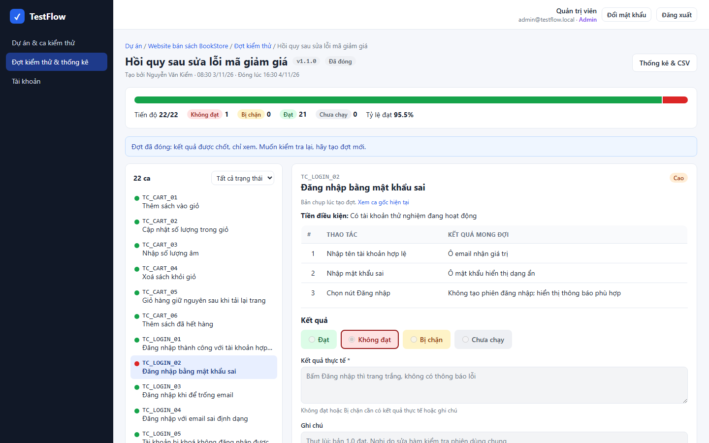

*Hình 3.10. Đợt đã đóng: ca TC_LOGIN_02 Không đạt ở bản 1.1, chỉ xem*

### 3.2.7. Thống kê và xuất CSV

Màn hình thống kê (Hình 3.11) hiển thị tổng số ca, tiến độ, tỷ lệ đạt kèm công thức, số ca theo bốn trạng thái, bảng thống kê theo độ ưu tiên và danh sách các ca Không đạt, Bị chặn kèm kết quả thực tế. Hàm `computeStats` dùng chung cho danh sách đợt, chi tiết đợt và thống kê, đảm bảo một công thức duy nhất trong toàn hệ thống; khi mẫu số bằng 0, tỷ lệ đạt trả về `null` và giao diện hiển thị "Chưa có dữ liệu".

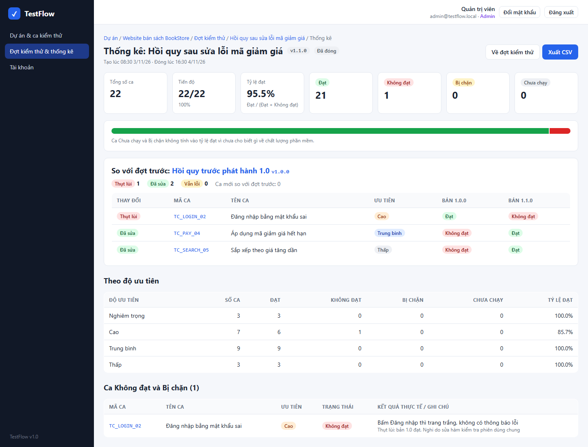

*Hình 3.11. Màn hình thống kê đợt kiểm thử bản 1.1*

Ngay dưới phần tổng hợp là mục **So với đợt trước**, phục vụ trực tiếp mục tiêu theo dõi kiểm thử hồi quy. Hệ thống tìm đợt liền trước của cùng dự án theo thời điểm tạo, ghép từng ca theo ca gốc (ca gốc đã bị xoá thì ghép theo mã ca) và phân loại: **thụt lùi** (trước Đạt, nay Không đạt), **đã sửa** (trước Không đạt, nay Đạt), **vẫn lỗi** (Không đạt ở cả hai đợt) và ca mới. Ở Hình 3.12, đợt bản 1.1 có tỷ lệ đạt tăng từ 90,5% lên 95,5%, nhưng phép so sánh vẫn chỉ ra ca TC_LOGIN_02 bị thụt lùi; nếu chỉ nhìn tỷ lệ đạt, lỗi này dễ bị bỏ qua. Logic so sánh được tách thành hàm thuần `compareRuns` để kiểm thử độc lập bằng unit test; đợt đầu tiên của dự án hiển thị thông báo chưa có đợt trước để so sánh.

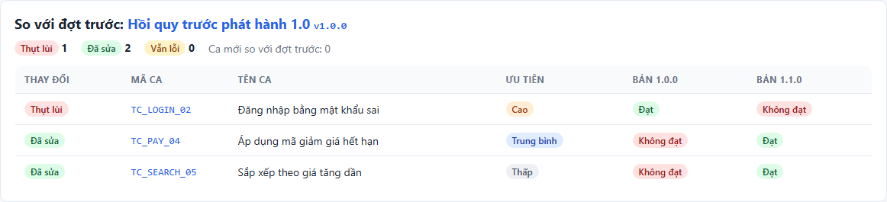

*Hình 3.12. So sánh đợt bản 1.1 với bản 1.0: một ca thụt lùi, hai ca đã sửa*

Nút "Xuất CSV" tải về tệp gồm phần thông tin đợt, số liệu tổng hợp và bảng từng ca (mã, tên, độ ưu tiên, trạng thái, kết quả thực tế, ghi chú, người thực hiện, thời điểm). Tệp mã hoá UTF-8 có BOM để Excel trên Windows hiển thị đúng tiếng Việt; mọi ô được bọc ngoặc kép theo RFC 4180 nên nội dung có dấu phẩy hoặc xuống dòng không làm vỡ cột. Vì API yêu cầu token, giao diện tải tệp bằng `fetch` kèm header rồi tạo liên kết tải xuống, thay vì dùng thẻ liên kết thông thường.

### 3.2.8. Tài liệu API

API được mô tả tự động bằng Swagger tại `/api/docs` (Hình 3.13), gồm 30 API chia theo nhóm, cho phép đăng nhập và thử gọi trực tiếp. Danh sách đầy đủ ở Bảng 2.12.

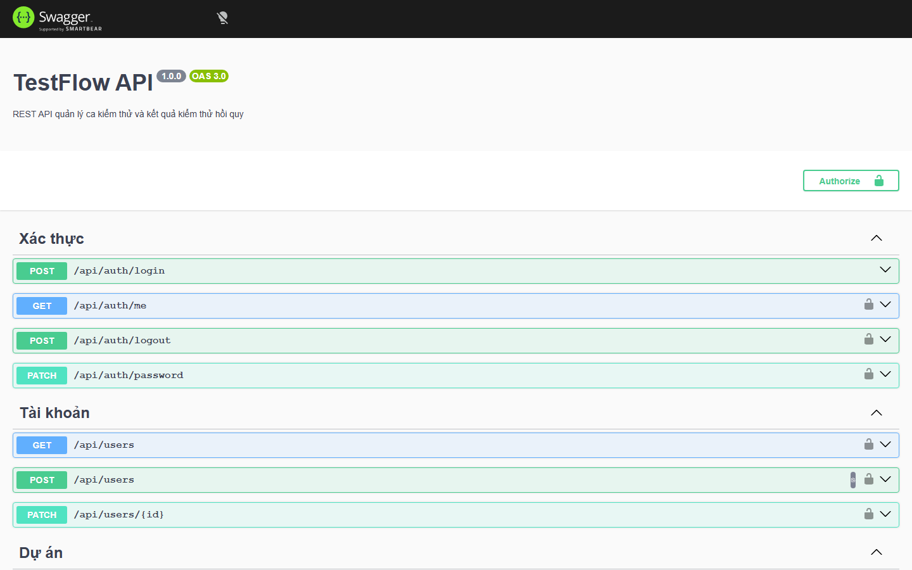

*Hình 3.13. Tài liệu API tự sinh bằng Swagger*

## 3.3. Dữ liệu mẫu và kịch bản demo

### 3.3.1. Dữ liệu mẫu

Lệnh `npm run db:seed` xoá sạch và tạo lại dữ liệu mẫu cố định (Bảng 3.3), để mọi lần demo bắt đầu từ cùng một trạng thái.

*Bảng 3.3. Dữ liệu mẫu*

| Loại dữ liệu | Số lượng | Chi tiết |
| --- | --- | --- |
| Tài khoản | 3 | Admin, Tester, một Tester đã bị khoá (dữ liệu giả lập) |
| Dự án | 2 | Website bán sách BookStore; Phần mềm quản lý thư viện |
| Bộ kiểm thử | 7 | Đăng nhập, Tìm kiếm sách, Giỏ hàng, Thanh toán; Mượn sách, Trả sách, Quản lý độc giả |
| Ca kiểm thử | 34 | 22 ca BookStore, 12 ca thư viện; tổng 47 bước |
| Đợt kiểm thử | 3 | Ba phiên bản BookStore 1.0, 1.1, 1.2 |

Ba đợt được xây dựng để kể một câu chuyện kiểm thử hồi quy có thật (Bảng 3.4).

*Bảng 3.4. Ba đợt kiểm thử mẫu của BookStore*

| Đợt | Phiên bản | Trạng thái | Kết quả | Tỷ lệ đạt | Diễn biến |
| --- | --- | --- | --- | --- | --- |
| Hồi quy trước phát hành 1.0 | 1.0.0 | Đã đóng | 19 Đạt, 2 Không đạt, 1 Bị chặn | 90,5% | Lỗi mã giảm giá hết hạn vẫn được áp dụng; lỗi sắp xếp theo giá |
| Hồi quy sau sửa lỗi mã giảm giá | 1.1.0 | Đã đóng | 21 Đạt, 1 Không đạt | 95,5% | Lỗi mã giảm giá đã sửa, nhưng TC_LOGIN_02 thụt lùi: trang trắng khi sai mật khẩu |
| Hồi quy trước phát hành 1.2 | 1.2.0 | Đang mở | 11 Đạt, 1 Bị chặn, 10 Chưa chạy | 100% | Đang thực hiện; đăng nhập đã đạt lại |

Giữa đợt 1.1 và 1.2, ca TC_LOGIN_02 được viết thêm bước thứ tư. Hai đợt cũ vẫn giữ bản chụp 3 bước, minh hoạ trực tiếp cơ chế bảo toàn lịch sử.

### 3.3.2. Kịch bản demo

Kịch bản demo khoảng 5 phút, bám theo luồng chính của đề tài:

1. Đăng nhập Tester; mở dự án BookStore, giới thiệu bộ và ca, tìm kiếm "LOGIN", lọc độ ưu tiên.
2. Mở ca TC_LOGIN_02: chỉ ra các bước và bảng lịch sử kết quả qua ba đợt (Đạt → Không đạt → Đạt).
3. Tạo đợt mới phiên bản 1.3 với các ca Nghiêm trọng.
4. Ghi một ca Không đạt nhưng bỏ trống mô tả để thấy hệ thống từ chối, sau đó nhập kết quả thực tế và lưu.
5. Mở ca gốc, thêm một bước và lưu; quay lại đợt vừa tạo để chứng minh bản chụp vẫn giữ số bước cũ.
6. Đóng đợt, mở thống kê; mở thống kê đợt bản 1.1 để thấy mục So với đợt trước chỉ ra ca thụt lùi TC_LOGIN_02; xuất CSV và mở bằng Excel.
7. Đăng nhập Admin: khoá tài khoản Tester và chứng minh phiên của Tester bị từ chối ngay; thử gọi API quản lý tài khoản bằng Tester để thấy mã 403.

## 3.4. Kiểm thử

### 3.4.1. Chiến lược kiểm thử

TestFlow được kiểm thử tự động ở ba mức (Bảng 3.5). Cả ba bộ kiểm thử đều chạy lại được bằng một lệnh, đóng vai trò như một đợt kiểm thử hồi quy cho chính TestFlow sau mỗi lần sửa mã.

*Bảng 3.5. Các mức kiểm thử*

| Mức | Công cụ | Phạm vi | Số lượng | Lệnh |
| --- | --- | --- | --- | --- |
| Unit test | Jest | AuthService, RolesGuard, công thức thống kê, so sánh hai đợt; không cần CSDL | 12 | `npm test` |
| Kiểm thử API | Jest, Supertest | Toàn bộ chuỗi Guard, Pipe, Service trên CSDL PostgreSQL thật | 44 (TS-01…TS-44) | `npm run test:e2e` |
| Kiểm thử đầu cuối | Playwright, Chromium | Ba luồng nghiệp vụ trên trình duyệt thật | 3 (E2E-01…E2E-03) | `npm test` trong `e2e` |

Mỗi bộ kiểm thử API và E2E tự tạo dữ liệu riêng (dự án có tên kèm dấu thời gian) và dọn dẹp sau khi chạy, nên không phụ thuộc vào thứ tự và không làm hỏng dữ liệu demo.

### 3.4.2. Kết quả kiểm thử API

Bảng 3.6 liệt kê 44 tình huống kiểm thử API. Lần chạy ngày 20/11/2026: **44/44 đạt**, cùng 12/12 unit test đạt. Nhật ký chạy đầy đủ lưu tại `docs/ket-qua/kiem-thu-tu-dong.txt`.

*Bảng 3.6. Tình huống kiểm thử API và kết quả*

| Mã | Tình huống | Kết quả mong đợi | Kết quả |
| --- | --- | --- | --- |
| TS-01 | Đăng nhập đúng | 200, trả token | Đạt |
| TS-02 | Sai mật khẩu | 401 | Đạt |
| TS-03 | Email sai định dạng, thiếu mật khẩu | 400 kèm thông báo từng trường | Đạt |
| TS-04 | Tài khoản bị khoá đăng nhập | 401 | Đạt |
| TS-05 | Gửi kèm trường lạ `role` khi đăng nhập | 400 | Đạt |
| TS-06 | Email viết hoa, có khoảng trắng | Vẫn đăng nhập được | Đạt |
| TS-07 | Gọi API không có token | 401 | Đạt |
| TS-08 | Token giả mạo | 401 | Đạt |
| TS-09 | Xem người dùng hiện tại | Không chứa `passwordHash` | Đạt |
| TS-10 | Tester xem danh sách tài khoản | 403 | Đạt |
| TS-11 | Tester tạo tài khoản | 403 | Đạt |
| TS-12 | Tester lưu trữ dự án | 403 | Đạt |
| TS-13 | Admin tạo tài khoản; mật khẩu yếu; trùng email | 201; 400; 409 | Đạt |
| TS-14 | Admin khoá tài khoản đang đăng nhập | Token cũ bị từ chối ngay (401) | Đạt |
| TS-15 | Admin tự khoá chính mình | 400 | Đạt |
| TS-16 | Tạo dự án thiếu tên; trùng tên | 400; 409 | Đạt |
| TS-17 | Tạo ca hợp lệ | 201, mã viết hoa, bước đánh số 1..n | Đạt |
| TS-18 | Tạo ca thiếu tên hoặc không có bước | 400 | Đạt |
| TS-19 | Bước thiếu kết quả mong đợi | 400 | Đạt |
| TS-20 | Trùng mã ca trong dự án | 409 | Đạt |
| TS-21 | Chọn bộ của dự án khác | 400 | Đạt |
| TS-22 | Tìm theo mã, tên; lọc độ ưu tiên | Đúng kết quả lọc | Đạt |
| TS-23 | Sửa ca thay toàn bộ bước | Bước mới đánh số lại | Đạt |
| TS-24 | Xoá bộ còn ca | 409 | Đạt |
| TS-25 | Thêm ca vào dự án đã lưu trữ; mở lưu trữ rồi thêm | 400; 201 | Đạt |
| TS-26 | Phân trang `pageSize` > 100 | 400 | Đạt |
| TS-27 | Tạo đợt hợp lệ | Đủ ca, Đang mở, mọi kết quả Chưa chạy, có bản chụp bước | Đạt |
| TS-28 | Tạo đợt không chọn ca; thiếu phiên bản | 400 | Đạt |
| TS-29 | Chọn trùng một ca trong đợt | 400 | Đạt |
| TS-30 | Chọn ca thuộc dự án khác | 400, không để lại đợt dở dang | Đạt |
| TS-31 | Sửa ca gốc sau khi tạo đợt | Bản chụp trong đợt giữ nguyên | Đạt |
| TS-32 | Xoá ca gốc | Đợt cũ vẫn còn bản chụp và kết quả | Đạt |
| TS-33 | Thống kê khi chưa có kết quả | Tiến độ 0, tỷ lệ đạt "chưa có dữ liệu" | Đạt |
| TS-34 | Ghi Đạt | Lưu người thực hiện, thời điểm | Đạt |
| TS-35 | Ghi Không đạt, Bị chặn thiếu mô tả; có mô tả | 400; 200 | Đạt |
| TS-36 | Trạng thái kết quả không hợp lệ | 400 | Đạt |
| TS-37 | Công thức thống kê | Tỷ lệ đạt = Đạt/(Đạt+Không đạt), Bị chặn không tính | Đạt |
| TS-38 | Xuất CSV | UTF-8 có BOM, tiếng Việt, đủ cột | Đạt |
| TS-39 | Lịch sử ca qua các đợt | Đúng các đợt và kết quả | Đạt |
| TS-40 | Đóng đợt; đóng lần hai | 200; 400 | Đạt |
| TS-41 | Sửa kết quả của đợt đã đóng | 400, kết quả cũ giữ nguyên | Đạt |
| TS-42 | Gọi API đợt không có token | 401 | Đạt |
| TS-43 | Dự án đã lưu trữ | Không tạo đợt được, vẫn xem được lịch sử | Đạt |
| TS-44 | So sánh với đợt trước | Chỉ ra đúng ca thụt lùi, ca đã sửa; đợt đầu tiên không có so sánh | Đạt |

Các tình huống bao phủ đủ tám trường hợp kiểm thử trọng tâm của kế hoạch: truy cập vượt quyền (TS-10…TS-12), tạo ca thiếu trường (TS-18, TS-19), lưu kết quả không hợp lệ (TS-35, TS-36), sửa ca gốc sau khi tạo đợt (TS-31), sửa kết quả của đợt đã đóng (TS-41), thống kê khi chưa có kết quả (TS-33), xuất CSV có dấu tiếng Việt (TS-38) và lưu trữ dự án mà vẫn giữ lịch sử (TS-43).

### 3.4.3. Kết quả kiểm thử đầu cuối

Ba luồng E2E chạy trên trình duyệt Chromium với độ phân giải 1440×900, thao tác như người dùng thật: nhập liệu, bấm nút, xác nhận hộp thoại, tải tệp (Bảng 3.7). Lần chạy ngày 20/11/2026: **3/3 đạt** (nhật ký: `docs/ket-qua/e2e-playwright.txt`).

*Bảng 3.7. Ba luồng kiểm thử đầu cuối*

| Mã | Luồng | Các điểm kiểm tra | Kết quả |
| --- | --- | --- | --- |
| E2E-01 | Đăng nhập và tạo ca | Đăng nhập sai bị từ chối; gửi biểu mẫu trống hiện lỗi tiếng Việt; tạo ca 2 bước; mã ca tự viết hoa | Đạt |
| E2E-02 | Tạo đợt và ghi kết quả | Tạo đợt 3 ca; Không đạt thiếu mô tả bị từ chối; ghi Không đạt, Đạt, tiến độ tăng đúng; sửa ca gốc thêm bước; lịch sử ghi "(hiện 3)"; bản chụp trong đợt vẫn 2 bước | Đạt |
| E2E-03 | Đóng đợt, thống kê, CSV | Đóng đợt qua hộp thoại xác nhận; ô nhập bị khoá; tỷ lệ đạt 50,0%, tiến độ 2/3; đợt đầu tiên báo chưa có đợt trước để so sánh; tải CSV đúng tên tệp, có BOM, đúng nội dung tiếng Việt | Đạt |

Trong quá trình viết kiểm thử E2E đã phát hiện và sửa hai lỗi giao diện: chấm trạng thái trong danh sách ca bị kéo dài thành thanh ngang do xung đột độ ưu tiên CSS, và tiêu đề các cột số căn trái trong khi số căn phải. Hai lỗi này không ảnh hưởng chức năng nhưng cho thấy giá trị của việc kiểm tra trên trình duyệt thật.

### 3.4.4. Đo hiệu năng

Mục tiêu theo kế hoạch: p95 thời gian phản hồi API danh sách dưới 1 giây với 1.000 ca kiểm thử và 5 người dùng đồng thời. Kịch bản `npm run perf` tự tạo một dự án tạm gồm 1.000 ca, 3.000 bước, 5 bộ; cho 5 người dùng ảo gửi yêu cầu liên tục trong 30 giây với năm loại truy vấn luân phiên (phân trang ngẫu nhiên, tìm theo mã, lọc theo bộ, lọc theo độ ưu tiên, tìm theo tên với 100 ca mỗi trang); sau đó xoá dự án tạm.

*Bảng 3.8. Kết quả đo hiệu năng API danh sách ca*

| Chỉ số | Giá trị |
| --- | --- |
| Điều kiện | 1.000 ca, 5 người dùng đồng thời, 30 giây; API bản production và PostgreSQL chạy cùng máy |
| Máy đo | Intel Core i5-12500H (16 luồng), 16 GB RAM, Windows 11, Node.js 22.12 |
| Tổng số yêu cầu / lỗi | 8.967 / 0 |
| Thông lượng | 298,9 yêu cầu/giây |
| p50 / p95 / p99 | 15 ms / 33 ms / 41 ms |
| Lớn nhất | 69,2 ms |
| Đánh giá | **Đạt** mục tiêu p95 < 1.000 ms |
| Đo bổ sung | Tạo một đợt chứa đủ 1.000 ca (1.000 bản chụp trong một giao dịch): 855 ms; xem chi tiết đợt 1.000 ca: 63 ms |

Giới hạn của phép đo: đo trên máy cá nhân, máy khách và máy chủ chạy cùng máy nên không tính độ trễ mạng; kết quả chỉ đại diện cho quy mô nhóm nhỏ mà đề tài hướng tới. Số liệu gốc lưu tại `docs/ket-qua/hieu-nang.json`.

### 3.4.5. Thử sao lưu và phục hồi

Bản PostgreSQL nhúng không kèm công cụ `pg_dump`, nên đề tài cài đặt sao lưu logic bằng hai kịch bản: `npm run db:backup` đọc toàn bộ 8 bảng ra một tệp JSON kèm mã băm SHA-256; `npm run db:restore` kiểm tra mã băm của tệp, xoá dữ liệu hiện tại và nạp lại theo thứ tự cha trước con trong một giao dịch, đặt lại bộ đếm khoá chính, rồi so sánh mã băm dữ liệu sau phục hồi với bản sao lưu. Cách này hoạt động với mọi máy chủ PostgreSQL.

Quy trình thử ngày 16/11/2026 (nhật ký: `docs/ket-qua/sao-luu-phuc-hoi.txt`):

1. Sao lưu dữ liệu demo: 3 tài khoản, 2 dự án, 7 bộ, 34 ca, 47 bước, 3 đợt, 66 bản chụp, 66 kết quả.
2. Giả lập sự cố: xoá đợt kiểm thử số 2 và toàn bộ 5 ca của bộ Thanh toán.
3. Phục hồi từ bản sao lưu: số bản ghi từng bảng khớp; mã băm dữ liệu sau phục hồi **khớp hoàn toàn** với bản sao lưu.
4. Kiểm tra qua API: đăng nhập lại thành công, đủ 3 đợt với đúng tỷ lệ đạt, đủ 5 ca Thanh toán; tạo bản ghi mới sau phục hồi không bị trùng khoá.

Kết quả: **phục hồi thành công**, đáp ứng tiêu chí "một lần thử phục hồi CSDL" của kế hoạch.

## 3.5. Đánh giá

### 3.5.1. Đối chiếu với mục tiêu

*Bảng 3.9. Đối chiếu kết quả với mục tiêu đề ra*

| Mục tiêu | Chỉ tiêu | Kết quả đạt được | Đánh giá |
| --- | --- | --- | --- |
| Nhóm chức năng | 6 nhóm | 6/6 nhóm hoạt động, 20 yêu cầu chức năng | Đạt |
| Vai trò | 2 vai trò, kiểm tra quyền tại backend | Admin, Tester; Guard toàn cục; TS-10…TS-12 | Đạt |
| Bảo toàn lịch sử | Sửa, xoá ca gốc không đổi đợt cũ | Bản chụp; TS-31, TS-32, E2E-02 | Đạt |
| Dữ liệu mẫu | 2 dự án, ≥ 30 ca, 3 đợt | 2 dự án, 34 ca, 3 đợt | Đạt |
| Tình huống kiểm thử | ≥ 30 | 44 tình huống API, 12 unit test | Đạt |
| Luồng E2E | 3 | 3 luồng Playwright | Đạt |
| Hiệu năng | p95 < 1 s, 1.000 ca, 5 người dùng | p95 = 33 ms | Đạt |
| Sao lưu, phục hồi | 1 lần thử thành công | Thành công, dữ liệu khớp mã băm | Đạt |
| Tài liệu | Hướng dẫn chạy, tài liệu API | README, hướng dẫn cài đặt, Swagger | Đạt |
| Đánh giá giá trị sử dụng | Thử 20 ca qua 2 phiên bản trên ứng dụng thật; so sánh thời gian với bảng tính; phản hồi người dùng | Dữ liệu mẫu đã có 22 ca qua 3 phiên bản. Chưa đo so sánh với bảng tính và chưa có phản hồi của người dùng bên ngoài | Chưa đạt đầy đủ |

### 3.5.2. Hạn chế

- **Chưa kiểm chứng với người dùng thực tế.** Toàn bộ thử nghiệm do sinh viên tự thực hiện trên dữ liệu tự xây dựng; chưa đo thời gian thao tác so với bảng tính và chưa có phản hồi của lập trình viên hay tester bên ngoài. Vì vậy báo cáo không kết luận về mức tiết kiệm thời gian hay khả năng ứng dụng tại doanh nghiệp.
- **Phân quyền đơn giản:** hai vai trò dùng chung dữ liệu, chưa phân quyền theo từng dự án.
- **Lịch sử trong một đợt:** mỗi ca trong đợt chỉ lưu kết quả hiện hành, chưa lưu mọi lần sửa kết quả trước khi đóng đợt.
- **Phiên đăng nhập:** đăng xuất chỉ xoá token phía trình duyệt; token bị lộ vẫn dùng được tới khi hết hạn (8 giờ), trừ khi tài khoản bị khoá. Token lưu trong `localStorage`, nếu trang có lỗi XSS thì token có thể bị đọc; React tự thoát ký tự khi hiển thị nên giảm rủi ro này.
- **Triển khai:** mới chạy trên localhost; chưa triển khai trực tuyến.
- **Hiệu năng:** đo trên một máy, chưa tính độ trễ mạng và chưa thử quy mô lớn hơn nhóm nhỏ.

## Kết luận chương 3

Chương 3 đã trình bày kết quả cài đặt đầy đủ sáu nhóm chức năng theo thiết kế, với 10 màn hình giao diện và 30 API, trong đó phép so sánh với đợt trước tự động chỉ ra ca thụt lùi. Cơ chế bảo toàn lịch sử bằng bản chụp, khoá đợt đã đóng và lưu trữ dự án được cài đặt và kiểm chứng bằng cả kiểm thử API lẫn kiểm thử đầu cuối. Sản phẩm đạt 44/44 tình huống kiểm thử API, 12/12 unit test, 3/3 luồng E2E; p95 của API danh sách là 33 ms với 1.000 ca và 5 người dùng đồng thời; thử phục hồi CSDL thành công. Hạn chế chính là chưa đánh giá với người dùng thực tế, được nêu rõ để không trình bày như kết quả đã đạt.
